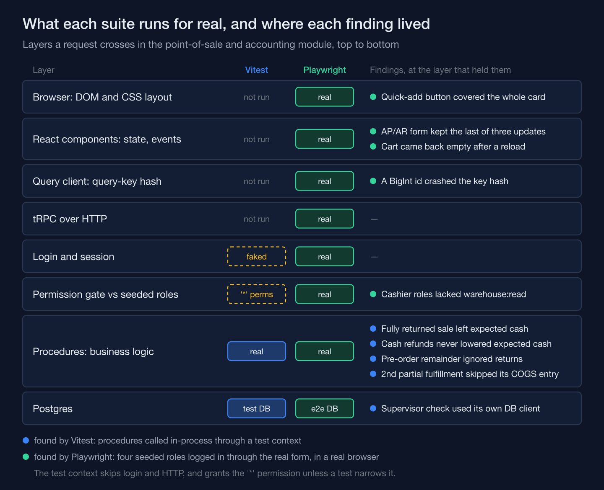
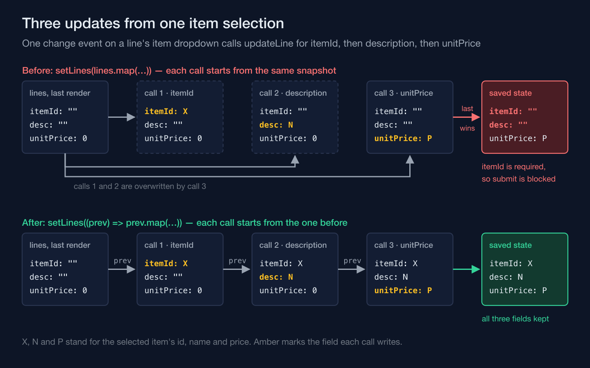

When a teammate built the automated test suite for the point-of-sale and accounting module of SentraOps ERP, the study-case ERP I lead, they wrote it in two passes: Vitest first, calling the module's server procedures against a real test database, then Playwright, driving the same flows through a real browser with real seeded roles. Each pass found bugs the other pass never would have — not because one layer is more thorough than the other, but because each one fakes away a different slice of reality. A browser test does not catch more bugs than a server-side test. It catches the ones living in whatever the server-side test had to pretend did not exist.



## Vitest's first pass found four bugs and a function it couldn't test

The first pass added eight Vitest files — shift handling, checkout, customer credit, cart and catalog, discount and promo, pre-order fulfillment, returns, and report reconciliation — plus a thirteen-step full-cycle integration test that walked the whole purchase-to-cash chain: PR to PO to goods receipt to AP to payment, then SO to goods issue to AR to payment, into the POS, through to closing the books. Every case called the same procedures the app calls, with a real Postgres test database behind them. Writing that suite against what the flows were documented to do surfaced five findings: a shift's expected cash that dropped a fully returned sale entirely instead of subtracting its refund, cash refunds that never reduced expected cash at all, a pre-order whose remaining quantity ignored what the customer had already returned, a second partial fulfillment whose cost-of-goods journal was silently skipped because the idempotency guard saw the same reference twice — the real root cause of a defect already on the known-issues list — and a supervisor-verification function that imported the app's database client directly, so its success path couldn't run against the test database at all.

None of those became a ticket filed and forgotten. Three went in as **expected failures** — Vitest's `it.fails`, a test that passes only while its assertion still fails. The day someone fixes the underlying code, that test turns red, and the only way to get the suite green again is to drop the marker, which leaves it behind as a permanent regression guard. The shift-cash finding was pinned the other way around, as an ordinary test asserting the wrong value the code actually returns, with the right one in a comment beside it. The supervisor check was skipped explicitly, with a note saying why. Either way each bug had a name and a reproduction instead of a line item that could quietly drop off a backlog, or a conversation that was never written down anywhere a CI run could enforce it.

## A real login found a permission row Vitest never queried

The second pass set up Playwright properly: a config; a global setup that resets a separate end-to-end database, seeds it, and logs four roles in through the real login form, saving each session with `storageState`; an extra seed fixture for end-to-end scenarios; and a `fieldFor` helper for POS fields whose labels skip `htmlFor`. Three spec files later, twelve of twelve tests were green. But getting there meant actually logging in as each role and clicking through the real POS terminal — and for the `kasir` (cashier) and `spv-pos` (POS supervisor) roles, the warehouse dropdown in the terminal came up empty.

The cause wasn't a rendering bug. The terminal fills that dropdown from the warehouse list procedure, and neither role had a `warehouse:read` permission row in the seed data at all, so the query came back forbidden — and with no warehouse to pick, a cashier on that seed couldn't have opened a shift. The Vitest specs could never have caught this, not because they were careless, but because of how they reach the server: every caller is built from a fake context that skips login and, unless a test narrows it, carries the wildcard permission. They never route through a real login and a permission gate checked against the role rows the app ships with. A missing permission is **data**, not logic, and no amount of coverage over the logic will ever notice that a seed table is short one row. You need something that actually logs in as that role and asks the real gate a real question.

## A real query client found a BigInt its hash function cannot swallow

Logging in for real also meant going through the real TanStack Query client for the first time in this test suite — something the Vitest specs never touch, since they call server procedures directly and skip the client cache entirely. That surfaced a second, sharper crash: "Do not know how to serialize a BigInt." The ids in this app — a company's, a warehouse's, an item's — come straight off Postgres `bigint` columns through Prisma as JavaScript `BigInt` values, and several queries pass them into the query key as-is; the shift lookup the terminal runs takes the selected warehouse id. TanStack Query hashes every key with `JSON.stringify` to decide whether two calls share a cache entry, on every render and whether or not the query is enabled, and `JSON.stringify` throws the instant it meets a raw BigInt. So the terminal crashed outright the moment a warehouse was picked. A mocked network layer, or a server procedure called directly in a test, never builds that key and never runs that hash — the crash exists only once a real `QueryClient` is handed a real BigInt to hash.

The fix went in once, in the module that sets up the query client, rather than hunting down and converting every call site that happens to pass a BigInt (comment translated):

```ts
// TanStack Query hashes query keys with JSON.stringify (see hashKey in
// @tanstack/query-core), which throws on a raw BigInt — and this app sends
// several ids (companyId/warehouseId/itemId, etc.) as BigInt directly. The
// polyfill is installed once at the client's entry point so every
// useQuery/useInfiniteQuery in the app is safe, instead of patching every caller.
if (typeof (BigInt.prototype as { toJSON?: unknown }).toJSON !== "function") {
  (BigInt.prototype as unknown as { toJSON: () => string }).toJSON = function toJSON(this: bigint) {
    return this.toString();
  };
}
```

One guard, installed where the client first loads, covers every query this app has today and every one it will add later. The same setup turned up a third problem of the same family: the POS cart was saved to the database on every change, but the terminal never read it back, so a browser reload showed an empty cart. That one went in the way the first pass's known issues had, as an expected failure — Playwright's `test.fail()`.

## Finishing the browser layer found a form that had never worked

The remaining seven Playwright spec files closed the suite at thirty-three of thirty-three green across ten files, with the reload test counted as its expected failure — and writing them found two more production bugs. The sharper one made the AP and AR invoice creation forms completely unusable. Selecting an item fires three updates in the same handler: the item id, then its description, then its unit price, each one going through the same `updateLine` call (the comment is mine):

```tsx
onChange={(e) => {
  const item = items?.items.find((it: any) => it.id.toString() === e.target.value);
  // Three calls, one event: before the fix each read the same stale `lines`
  // closure, so only the last of these three ever stuck.
  updateLine(i, "itemId", e.target.value);
  if (item) {
    updateLine(i, "description", item.name);
    updateLine(i, "unitPrice", parseFloat(item.normalPrice?.toString() ?? "0"));
  }
}}
```

`updateLine` used to close over the `lines` array as it stood at the last render — `setLines(lines.map(…))` — so three calls firing inside one event all started from that same, already-outdated snapshot, and only the last call's change actually landed. The price and subtotal filled in, but `itemId`, a required field, was back to empty, so the browser's own validation blocked every submit with "Please select an item in the list." The form had never worked, for any line. The fix reads from React's own queue instead of a captured snapshot (the comment is mine):

```tsx
// prev is React's latest queued state, not whatever `lines` this closure
// captured — three updateLine calls in one event now each build on the one
// before it, instead of all overwriting the same stale copy.
const updateLine = (i: number, field: keyof APLine, value: string | number) => {
  setLines((prev) => prev.map((l, idx) => idx === i ? { ...l, [field]: value } : l));
};
```



This bug has nothing to do with business rules, and nothing the server-side layer runs could have reached it: those tests call procedures, and never render a form or fire a change event. A component-level test that fired the real three-call sequence would have caught it too — the deciding factor was whether a test drove the real component, not which runner drove it. The second bug from those specs was the same kind of thing in CSS. The POS product grid's quick-add button, `absolute inset-0` and invisible until hover, sat inside an image area with no `relative` on it, so it stretched over the whole product card, name and price included. Every click meant to open the product's detail dialog — the only place to switch an item to pre-order — landed on quick-add instead. The fix was one word, `relative`, on the image container.

What decides whether a test catches a bug was never which runner was holding the pen — it's how much of the real system that test still refused to fake.
