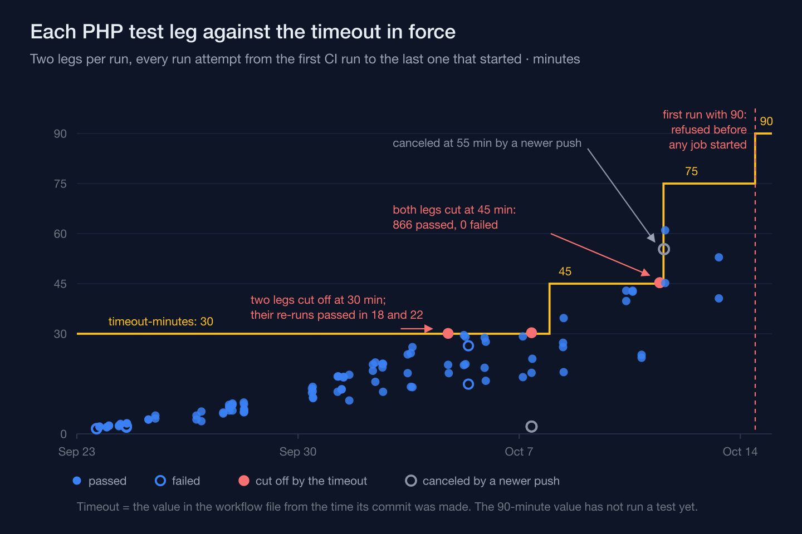
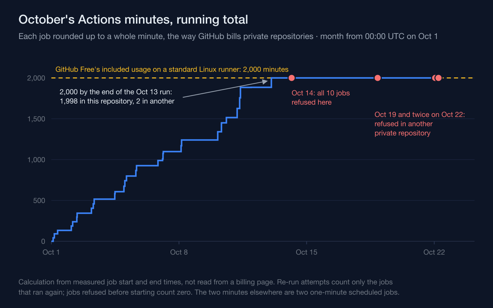
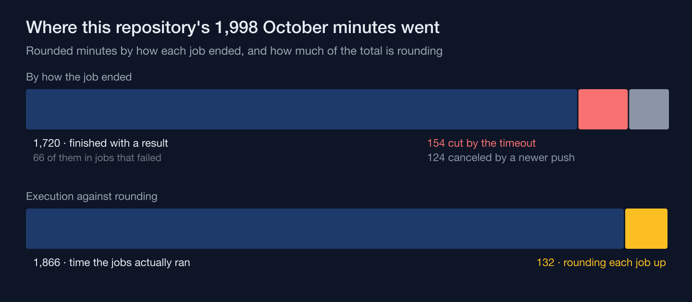

A `timeout-minutes` value answers one question: how long can this job run before I'd rather call it stuck? On the training-academy information system I'm building, I answered that question three times in seven days for the same test job — 30 minutes became 45, then 75, then 90 — and each answer had a run or a measurement behind it. None of them answered the question that actually stopped CI: how many full runs the month could still pay for. The repository is private, so every job draws on the account's included Actions usage — 2,000 minutes on this workflow's runners — and that ran out on a green run. The first push carrying the 90-minute limit was refused four minutes after I committed it, before a single job had started.

## Every raise was justified by a run that had nothing wrong with it

The workflow runs nine or ten jobs per push on GitHub-hosted Ubuntu runners: static analysis, assets, a security scan, a browser suite, resilience and restore rehearsals, a malware-scanner integration, a PDF job, and the main test job as a matrix of two PHP versions, 8.4 and 8.5. Both legs block a merge; the newer PHP version isn't allowed to fail quietly. Some limit has to be set, because leaving the key out lets a job run for 360 minutes before GitHub cancels it, and a hung job would burn all six hours.

The test job is the one that grew. The first CI runs took about two minutes a leg. In the first days of October a leg took 10 to 21 minutes. The first limit, 30 minutes, was hit twice in four days by the PHP 8.5 leg, both times on what turned out to be a slow runner: re-running the same commits finished the leg in 18 and 22 minutes. The second time, the leg had been stopped in the middle of the authorization suite without a single failing test. The workflow comment I wrote when I raised it to 45 records the reason in one line — the feature suite alone took 13 to 29 minutes depending on the runner. A limit set near the typical duration is a limit that fails on a slow machine, and "exceeded the maximum execution time" says nothing about the code.

Four days later 45 went the same way. Both legs were canceled at 45m17s, in the middle of the feature suite, with 89 of 192 test files done, 866 tests passed and none failed. One feature test class had run for 2,156 seconds on the CI runner by itself, 36 minutes of a 45-minute budget. I projected the full job at about an hour and set 75.



## The last raise came from a projection, and no test has run under it

The third raise didn't wait for a failure. The next batch of work added 35 test files and 182 tests, about 228 seconds locally, and the slow class itself had barely moved: 1,940 seconds against 1,887 locally. The local gate showed each suite growing at its own rate — the feature suite by a factor of 1.10, authorization 1.38, integration 1.22, browser 1.28. Applied to the PHP 8.5 leg of the two most recent CI runs, those ratios gave two projections: about 59 minutes from a main-line run that had taken 52m56s, and about 68 from a pull-request run that had taken 61m00s. The rule I had set myself was to stop and decide before pushing whenever a projection came within ten minutes of the limit, and 68 was past the 65-minute line. The options were to push and see, restructure the slow class, postpone, or raise the limit. I raised it. Translated and condensed, the workflow now reads:

```text
tests:
  name: tests (PHP ${{ matrix.php }})
  runs-on: ubuntu-24.04
  # 90 minutes: the PHP 8.5 leg projects to 59–68 min once the new tests land
  # (local per-suite growth applied to the last two CI runs), past the 65-min line
  # that keeps ten minutes of headroom under 75. Earlier: 75 (after both legs were cut
  # at 45 with no failing test) and 45 (after a leg was cut at 30); 30 was the first value.
  timeout-minutes: 90
```

The projection was careful. It's also still a projection. The push that carried it was refused before any job started, and no run of this workflow has started since, so the 90-minute value has never timed a single test.

## A full run more than doubled in minutes while each timeout looked at one job

GitHub bills private-repository jobs per job, each rounded up to the next whole minute, and the included usage belongs to the account, not to any one repository. So the number that matters for the month isn't how long the slowest leg runs. It's the sum over every job in the run, rounded, times the number of runs. On the first of October a full run cost 42 to 50 rounded minutes. Ten days later the same workflow, with one job more, cost 128: two legs of 45 and 61 minutes made up most of it, and the other eight jobs added about twenty.

Every change paid for that twice, because the workflow runs on pull requests and again on pushes to main. Eight main-line runs took 500 of October's minutes, a quarter of the month, spent running each merged change a second time. Rounding is the quieter tax: nine or ten jobs a run, each rounded up, added 132 minutes to the 1,866 the jobs actually ran — about seven percent, a cost that grows with the number of jobs, not with how long they run.

## The month's minutes ran out on a green run

GitHub counts Actions usage per calendar month from midnight UTC on the first, and on GitHub Free the included usage comes to 2,000 minutes on a standard Linux runner. My count from the job start and end times, with re-run attempts counting only the jobs that actually ran again, put this repository at 1,998 rounded minutes by the end of a main-line run on the 13th — a run that passed. Another private repository on the same account had used two, in two one-minute scheduled jobs. Together: 2,000.

The next push was the one carrying the 90-minute limit. All ten jobs came back within about two seconds each, with the same annotation:

```text
The job was not started because recent account payments have failed or your
spending limit needs to be increased. Please check the 'Billing & plans'
section in your settings
```

No test failed and no job ran, and on the pull request it looked exactly like a red run. GitHub's billing documentation describes the mechanism: once the included usage is consumed, an account without a valid payment method is blocked, and one with a payment method can still be stopped by a budget. Because that usage belongs to the account, the refusal didn't stay in this repository. A scheduled job in the other private repository was refused with the same annotation a few days later, and a deploy there was refused twice on the 22nd.



## One minute in seven bought no result at all

Of this repository's 1,998 minutes, 278 went to jobs that were canceled before they could report anything. 154 were test legs cut off by the timeout: the two 30-minute cuts and the two 45-minute ones, each a full timeout plus the minute rounding added (31, 31, 46 and 46), for an answer of "exceeded the maximum execution time". A tight limit isn't thrift. The leg cut at 30 minutes and re-run in 22 cost 54 rounded minutes for one passing result.

The other 124 were jobs canceled by a newer push. The workflow's concurrency group cancels an in-progress run on the same branch or pull request when a new one arrives, which is the right call two minutes in and an expensive one later. One run on the 11th had both legs at 55 minutes when a push canceled it, and its replacement then needed 45 and 61 minutes for the same two legs.



## A timeout change is a budget change, and it should say so

The timeout decisions weren't wrong; each was a correct answer about one job. What they lacked was a second line about the month: minutes per full run times expected runs, against the included usage. At 115 to 128 rounded minutes a run, 2,000 minutes buys about sixteen full runs. October had already started 31 run attempts by the 13th, most of them on the cheaper suite of the first week. The projection that justified 90 minutes had every number it needed to say "about sixteen runs a month at this size, fewer after the next batch of tests" — it just wasn't asked.

The working notes for this repository now carry that lesson as three operating rules. Before pushing, expect that CI may not start. Once CI can start again — the billing sorted out or the month reset — re-run the refused run on the same commit instead of pushing an empty commit to trigger it. And keep runs down, because every push re-runs the whole workflow, not just the job that changed.

A timeout tells a runner when to give up on one job; only the month's minutes decide whether the next job starts at all.

---

## Sources

- GitHub — *Workflow syntax for GitHub Actions* (`jobs.<job_id>.timeout-minutes` is the maximum number of minutes a job may run before GitHub cancels it, default 360; `cancel-in-progress: true` also cancels a currently running job or workflow in the same concurrency group). Retrieved 2026-10-29. <https://docs.github.com/en/actions/reference/workflows-and-actions/workflow-syntax>
- GitHub — *Viewing job execution time* (billable job execution minutes for private repositories on GitHub-hosted runners are rounded up to the next minute). Retrieved 2026-10-29. <https://docs.github.com/en/actions/how-tos/monitor-workflows/view-job-execution-time>
- GitHub — *GitHub Actions billing* (private-repository usage draws on an account's included compute usage, which resets at the start of each billing cycle; the Free plan's included amount, at the per-minute rate the page lists for the standard 2-core Linux runner, comes to 2,000 minutes; once it is consumed, an account without a valid payment method is blocked, and spending with a payment method may be limited by budgets). Retrieved 2026-10-29. <https://docs.github.com/en/billing/concepts/product-billing/github-actions>
- GitHub — *Billing cycles* (metered usage has a fixed billing period that starts at 00:00:00 UTC on the first day of each month). Retrieved 2026-10-29. <https://docs.github.com/en/billing/concepts/billing-cycles>
- GitHub — *GitHub-hosted runners reference* (the standard `ubuntu-24.04` runner for private repositories has two x64 CPUs). Retrieved 2026-10-29. <https://docs.github.com/en/actions/reference/runners/github-hosted-runners>
