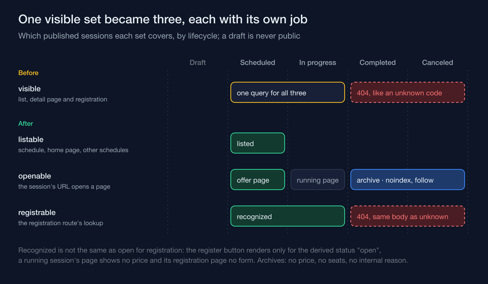
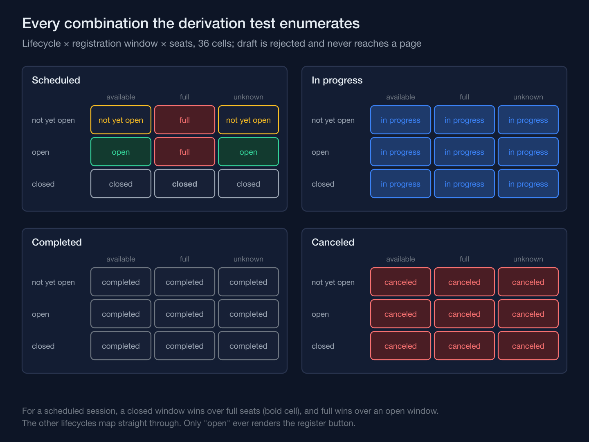

On a training-academy information system I'm building, every session that opens for enrollment eventually lands in one of two end states: it runs to completion, or it gets canceled. The question of what its public page should do next turned out not to be one question but three, and the first version of the public catalog answered all three with a single query, which worked right up until a finished session needed a different answer to each of them at once.

## Hiding a finished session and keeping it informative are opposite instincts

The first version had one definition of a visible session: published, and either scheduled or in progress. The same query fed the schedule list, the detail page and the registration form, and a separate check — registration window open on a scheduled session, and seats not full — decided whether the register button and the seat count appeared. Completed and canceled sessions were filtered out in the query, so the moment a published session finished, its page returned the same 404 as a code that had never existed. That was simple, and for a page whose link had already been shared, it was a dead end. The decision record for the redesign asks for the opposite: a finished or canceled session that was once published stays reachable by its URL as an informative page — not indexed, registration closed, no internal reason, a link to the program's other schedules — and appears neither in the upcoming schedule nor in the sitemap.

So the fix couldn't be to widen that one query. Adding completed sessions to the visible set would have put them back in the schedule, made the registration route recognize them, kept their pages indexable, and shown their price as if it were still an offer.

## Three separate questions replaced the one query

The actual design asks three independent things about every session, and a session can answer yes to one and no to another:

- **listable** — does it belong in the schedule a visitor browses, on the home page, and among a program's other schedules?
- **openable** — does its URL open a page at all?
- **registrable** — does the one lookup the registration route goes through recognize it?

A finished or canceled session is openable (its page exists, informatively) without being listable (it doesn't clutter the schedule a prospective customer is browsing) or registrable (there's no path back into the signup flow). Each of those three questions is its own query, built from one published-sessions helper with its own list of lifecycles (condensed):

```php
private function listable(): Builder
{
    return $this->published([BatchLifecycle::Scheduled]);
}

private function openable(): Builder
{
    return $this->published([
        BatchLifecycle::Scheduled, BatchLifecycle::InProgress,
        BatchLifecycle::Completed, BatchLifecycle::Cancelled,
    ]);
}

private function registrable(): Builder
{
    return $this->published([BatchLifecycle::Scheduled, BatchLifecycle::InProgress]);
}
```



A scheduled, upcoming session is all three. A session that's running is openable and registrable but no longer listable: the old query had kept it in the schedule, and the schedule now shows only sessions that haven't started. Registrable doesn't mean you can register, though. The registration route recognizes a running session and opens its page without a form; only one derived status, open, ever renders the register button, and the backend re-checks on submit regardless. A completed or canceled session is openable only. The status a visitor actually sees — open, full, not yet open, closed, in progress, completed, canceled — is a further derivation layered on top, combining lifecycle with the registration window and seat availability (the enum's class docblock, condensed and translated from the codebase's Indonesian, shown above the method):

```php
/**
 * Derivation order for a scheduled session: registration closed wins over
 * full (full + closed reads "Registration closed"), then full, then open;
 * everything else is not yet open. A draft is never public, so it has no
 * public status.
 */
public static function derive(BatchLifecycle $lifecycle, RegistrationWindow $window, Availability $availability): self
{
    return match ($lifecycle) {
        BatchLifecycle::Cancelled => self::Cancelled,
        BatchLifecycle::Completed => self::Completed,
        BatchLifecycle::InProgress => self::InProgress,
        BatchLifecycle::Scheduled => match (true) {
            $window === RegistrationWindow::Closed => self::Closed,
            $availability === Availability::Full => self::Full,
            $window === RegistrationWindow::Open => self::Open,
            default => self::NotOpen,
        },
        BatchLifecycle::Draft => throw new LogicException('A draft batch has no public status.'),
    };
}
```

That ordering — closed beats full, full beats open — is a business rule, not an accident of whichever `if` happened to run first. It only reads as deliberate because something enforces it on every possible input, which is the next piece.

## A page that still loads has to actively refuse to look like an offer

Being openable only buys a session the right to have a page. What that page is allowed to show still depends on which of the seven derived statuses it landed on, and each capability is its own yes/no method rather than a page template guessing from the status name:

```php
public function acceptsRegistration(): bool
{
    return $this === self::Open;
}

public function isArchive(): bool
{
    return in_array($this, [self::Completed, self::Cancelled], true);
}

public function showsPrice(): bool
{
    return in_array($this, [self::Open, self::Full, self::NotOpen, self::Closed], true);
}

public function showsSeats(): bool
{
    return in_array($this, [self::Open, self::NotOpen], true);
}
```

A completed or canceled session shows neither a price (it's no longer an offer) nor a seat count (it's no longer scarce), and the page is served with a `noindex, follow` directive instead of a normal indexable one — it should keep working for anyone who already has the link, and search engines should keep following its links to the rest of the catalog, but it has no business competing in search results against sessions you can actually join.

The internal reason a session was canceled gets the strictest treatment of all, and it's not because of a rule that filters it out before rendering. It's never in the data that reaches the page in the first place:

```php
final readonly class PublicBatch
{
    public function __construct(
        public string $batchId,
        public string $masterId,
        public string $code,
        public string $name,
        // ...price, schedule, location, status, seats, agenda, trainers
    ) {}
}
```

Its docblock calls it an allowlist: no online meeting link, no trainer contact, no internal notes, and no internal IDs beyond the ones registration and per-program grouping need. There's no field for a cancellation reason. The page test seeds a canceled session with an internal reason and asserts the text never appears in the HTML. The struct that assembles a public page has no slot a cancellation reason could occupy, so there's no later step — a conditional, a redaction, a permission check — that has to remember to strip it. The allowlist is the entire shape of the object; the leak that doesn't have a field to travel through doesn't need a filter to catch it.

The registration route is stricter still. For a completed, canceled, unpublished or draft session, both the GET and the POST return a 404 whose body is identical to the one for a code that doesn't exist, and a test compares the bodies after blanking the per-request nonce. The archive page admits the session existed; the registration route doesn't.

## An exhaustive test is what makes the ordering a rule instead of a habit

The precedence between closed, full, and open only means something if it's guaranteed to hold for every combination that can reach it, not just the ones that happened to show up in a demo dataset. The test for the derivation function doesn't sample. It enumerates every lifecycle except draft, crossed with every registration window, crossed with every availability state — thirty-six combinations, including ones the schema's CHECK constraints prevent from ever being stored — and compares each against a second copy of the rule written out in the test. It counts what it checked, and a separate test pins five rows by hand, among them full-and-closed reading as closed (condensed):

```php
$checked = 0;

foreach (BatchLifecycle::cases() as $lifecycle) {
    if ($lifecycle === BatchLifecycle::Draft) {
        continue;
    }

    foreach (RegistrationWindow::cases() as $window) {
        foreach (Availability::cases() as $availability) {
            expect(PublicBatchStatus::derive($lifecycle, $window, $availability))
                ->toBe($expected($lifecycle, $window, $availability));
            $checked++;
        }
    }
}

expect($checked)->toBe(4 * 3 * 3);
```



Thirty-six assertions from three small enums is cheap to write and easy to dismiss as overkill for what looks like a simple lookup table. The count earns its place the next time someone adds a fourth registration-window or seat state. The new combinations would fall to a default branch in both the rule and the test's copy of it, every row would still agree, and only the count at the end would fail — which is the difference between a red test and a status nobody decided on, three layers away from where anyone would think to look. A new lifecycle would fail even sooner, because the rule's outer match has no default at all.

One set of visible sessions was being asked whether a session belongs in the schedule, whether its page should load and whether it can still be sold, and a single answer to three questions is bound to be wrong about the session that has just ended.
