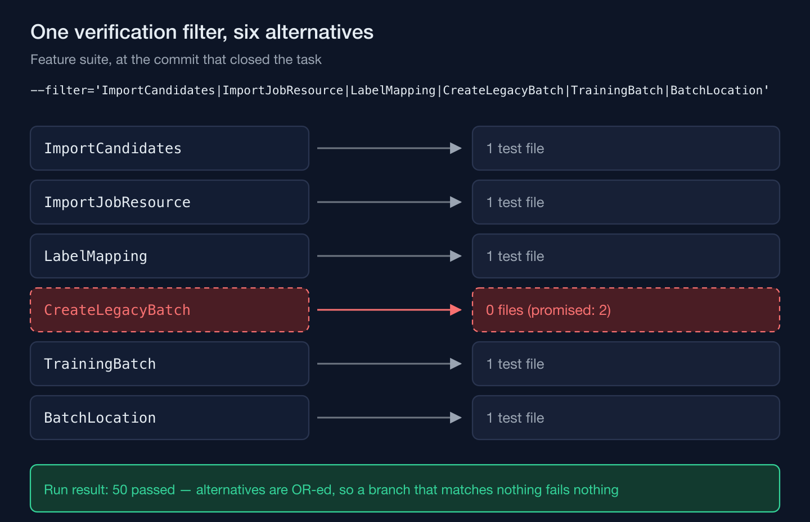
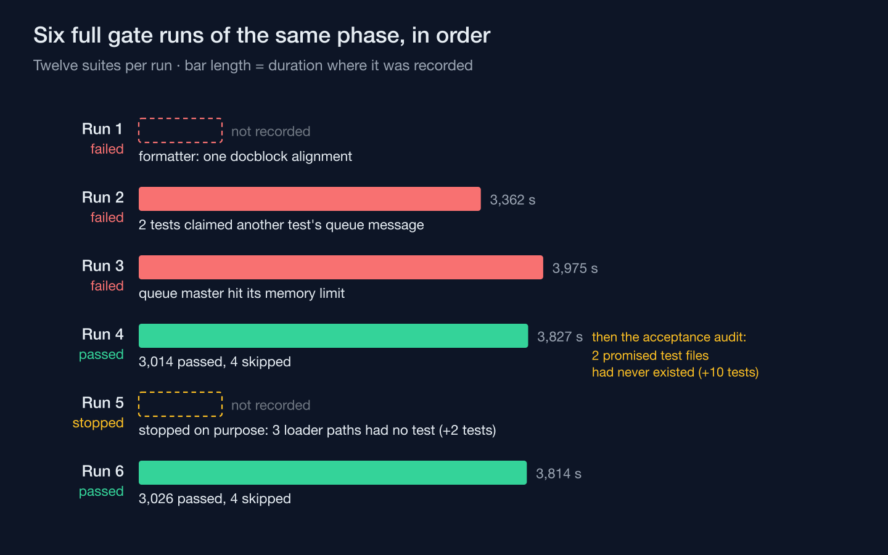

A task in the import module of a training-academy information system I'm building promised two test files and spelled out what each one had to prove. The task was closed, its verification command reported 50 passed, and a full gate across twelve suites later passed 3,014 tests. Neither file existed. Nothing that ran could have noticed, because every check measured the tests that were there, and none of them compared anything against the tests that had been promised. The gap surfaced only when an acceptance audit read the plan's list of named tests against the repository — and the same audit found a command whose documented refusals had no test at all.

## The verification line passed because one alternative matched nothing

The task's plan named the files outright: one test for the action that creates a historical training batch from legacy data, one for the step that decides whether a group of imported rows is allowed to become such a batch. It listed what they had to cover — the batch code format, the terminal status, the draft visibility, idempotent creation, every refusal. The verification recorded when the task closed ran the Feature suite through a single filter:

```text
--filter='ImportCandidates|ImportJobResource|LabelMapping|CreateLegacyBatch|TrainingBatch|BatchLocation'
```

Six alternatives in one pattern. Five of them matched a test file that existed. `CreateLegacyBatch` matched none, because the two files it was there to select had never been created. A filter is a pattern, and a pattern with alternatives is a disjunction: a branch that matches nothing removes nothing from the run and adds no failure to it. The run selected what the other five branches selected, every one of those tests passed, and the summary recorded "50 passed" — a true statement about the tests that ran and a silent one about the tests that didn't.



The filter was not careless. Folding related tests into one invocation is how a long suite stays affordable to run after every task, and the plan used the same style for its other verification steps. It worked here too, in the only sense the runner can report on.

## A full gate proves the tests that exist, and only those

The phase then went through its full gate: twelve suites, run in sequence, about an hour each time. It took four runs to go green. The first stopped on a formatter rule. The second failed after 3,362 seconds because two tests picked their queue messages by type and claimed messages that belonged to other tests' jobs. The third failed after 3,975 seconds when the queue's supervising process hit its memory limit. The fourth passed: 3,014 tests, four skipped, 3,827 seconds.



That fourth run is the one worth staring at. Every failure before it was a real defect the gate was built to catch, and the gate caught each one. And the run that passed made exactly the promise a gate makes — every test in the repository passes — while two of the tests the plan required were not in the repository to make any promise about. A gate has no list of tests that ought to exist. It can't fail on an absence it has no way to describe.

## The audit read the plan, not the test output

The phase's plan outline carries an acceptance table: each requirement, and next to it the tests that prove it. The row for the label dictionary and historical batches named three — the label-mapping Feature test, the historical-batch Feature test, and a browser test of the mapping screen. The acceptance audit took those names and checked each one against the files on disk, which is a different question from whether anything passes. The historical-batch test did not exist — and neither did the group-gate test that the task's own plan had listed beside it.

Part of the behavior had been exercised anyway, indirectly, through the label-mapping test — the worst kind of coverage to lean on, because it passes, and passing is exactly what makes nobody look for what's missing. The missing tests went in without a single change to application code: seven for the batch-creation action and three for the group gate, 109 assertions in about ten seconds. They pin the batch code prefix, the historical origin, the completed status with registration closed, the unpublished draft state, year-only dates, the empty capacity, price and time zone a legacy record can't know, a repeated creation key returning the same batch without a second audit entry, the location text that marks a venue as coming from old data, and each refusal — no year, an unrecorded or mixed delivery mode, an unmapped label, a group whose rows changed since it was offered — leaving no batch and no audit row behind. The finance role and a reviewer without batch-management permission are both refused.

The behavior was already right. What hadn't existed was the proof, and the difference matters the next time someone changes batch creation: before the audit, that change would have had a green suite and nothing in it that knew what "right" was.

## A refusal path nobody tests is a promise nobody checks

The same audit stopped the fifth gate run on purpose, partway through the Feature suite, because it had found three more gaps of the same kind in the command that loads the phase's synthetic truth set — a versioned dataset with written expectations, loaded through the real import pipeline. The command documents its refusals by reason, and three of them had no test. With the clock set just before the dataset's evaluation date, both load scopes must refuse without writing anything. With a load marker carrying a different checksum, both must refuse the same way. And when the malware scanner becomes unavailable partway through a load, the command must fail with that reason, leave no staging rows and no legacy facts behind, and — once the scanner is back — resume the same job rather than start a second one, finishing with one job per file and every reconciliation report matching its written expectation.

Two tests covered all three paths, again without touching application code, and the sixth run passed: 3,026 tests, four skipped, 3,814 seconds. The twelve extra tests are the whole difference between the two green runs. Each green run was honest. Only the second was complete.

## The record kept the mistake

The earlier task's summary did not get its verification line quietly rewritten. It got a correction appended: the two files named in the task were never created, the filter pattern meant to run them matched no test, the other alternatives in the same filter kept the run green, and so the gap went unnoticed until the acceptance audit — followed by where the tests were finally added. Anyone reading that summary later sees both the original claim and why it was incomplete, which is the only version of the history that teaches anything.

The check that would have caught it at task time costs almost nothing. Run each promised test file on its own, and treat zero tests selected as a failure, whatever the runner's exit status says. A filter that folds six patterns together answers whether the selected tests pass; it cannot answer whether each pattern selected anything, and that second question is the one a plan's list of promised tests is asking.

A green run tells you the tests you have pass; only the list of tests you promised can tell you which ones you don't have.
