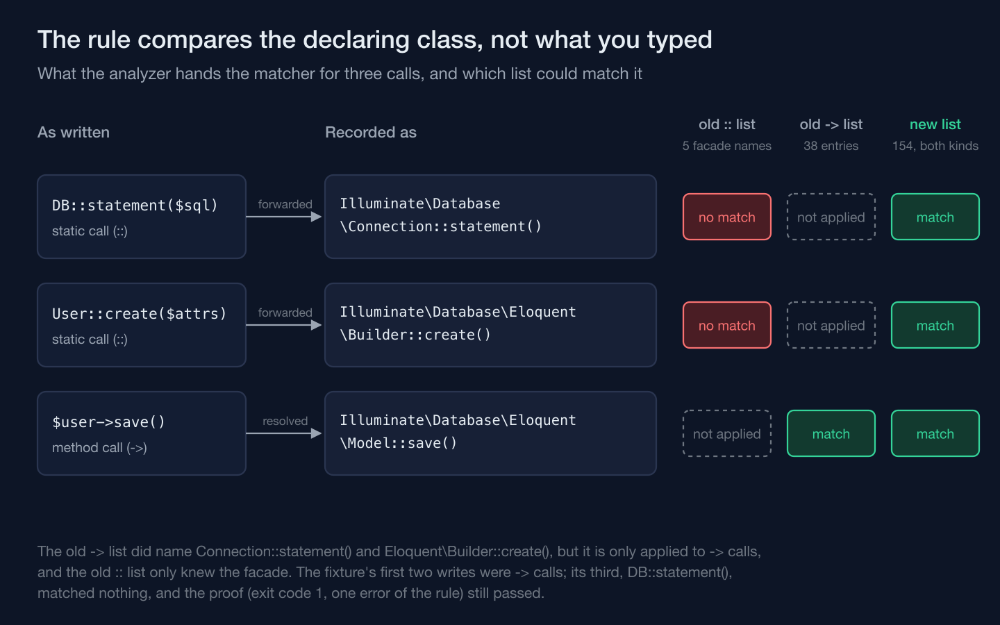
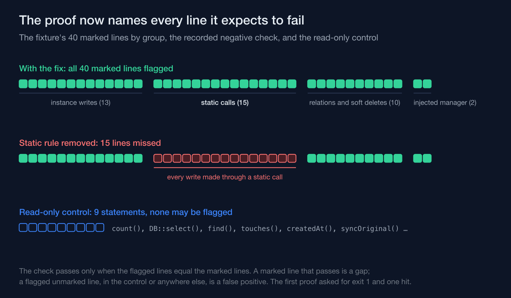

On a training-academy information system I'm building, a static-analysis rule is what keeps database writes inside a short list of places. In its first version, the half of that rule meant for static calls could not match anything. It listed calls the way you type them, `DB::statement()`, and the analyzer had already renamed every such call to the class that declares the method before the rule compared a single name. The rule's proof passed anyway, because it asked for an error on the fixture, not for an error on every line that should have one.

The boundary is simple to state. Inserts, updates, deletes, upserts, raw statements and in-place increments belong in the action class that owns the business operation, in one shared platform layer, or in migrations. Anywhere else, a write is a bug even when it writes the right thing. PHPStan runs at level 6 with Larastan, no baseline and no ignore list, and the package `spaze/phpstan-disallowed-calls` enforces the boundary with two lists: one for method calls written with `->`, one for static calls written with `::`. Both raise the same error identifier outside the allowed paths.

## A facade name is not the name the rule is compared against

Larastan is the extension that teaches PHPStan Laravel's dynamic parts, and part of that is forwarding. For `DB::statement($sql)`, the method it hands the rule is the one declared on the connection behind the facade, `Illuminate\Database\Connection::statement()`. Models get the same treatment: `User::create($attributes)` resolves to `Illuminate\Database\Eloquent\Builder::create()`, because the model's static `create()` passes through to an Eloquent builder. The disallowed-calls package then matches against that declaring class, along with its traits and interfaces, but not its parent classes.

The first version's static list named only the facade (condensed):

```text
disallowedStaticCalls:
    -
        method:
            - 'Illuminate\Support\Facades\DB::statement()'
            - 'Illuminate\Support\Facades\DB::unprepared()'
            - 'Illuminate\Support\Facades\DB::insert()'
            - 'Illuminate\Support\Facades\DB::update()'
            - 'Illuminate\Support\Facades\DB::delete()'
        errorIdentifier: 'app.directWrite'
```

The method list did name `Connection::statement()`, among 38 entries, but it only applies to `->` calls. So a `::` call was renamed to a class that only the method list knew, then checked against a list that only knew the facade. Neither list ever saw it.



## The rule's proof passed on a fixture where one write in three escaped

The rule shipped with a proof. A fixture outside the analyzed paths held three forbidden calls — `$user->save()`, an update through `DB::table()`, and `DB::statement()` — and the check was that analyzing it exited with code 1, reported the rule's identifier at least once, and had no internal or general errors. The first two are in the method list, the exit code was 1, and the proof passed. The third line was the call that escaped.

The gap was noticed within the same piece of work and first written down as a known limitation to record in the plan's summary: the disallowed-calls rule doesn't flag `DB::statement()` through the facade. I had it closed before the plan finished instead, and it turned out to be much wider than that note. What had escaped: the facade's `statement`, `unprepared`, `insert`, `update` and `delete`; the model statics `create`, `forceCreate`, `insert`, `upsert`, `updateOrCreate`, `firstOrCreate`, `createOrFirst`, `destroy` and `truncate`; `insertOrIgnore`, `incrementEach` and the magic `increment`; the relation writes `attach`, `sync`, `detach` and the `create` family; and the soft-delete `restore` and `forceDelete`. Some had escaped through forwarding, and the rest because the list never named the class that declares them, or never named the method at all. None of it had been pushed yet.

## One list for both kinds of call, written out by hand

The fix replaces the two lists with one: 154 entries written out from the Laravel 13 source, shared by the `->` rule and the `::` rule, so whichever class Larastan resolves a call to, the same list sees it. It names the declaring classes — `Model`, both builders, the connection, its interface and the database manager — and keeps the facade names as well. Twenty-six of the entries are patterns over the application's own module models, because Larastan declares the magic `increment()` on the concrete model, and a model that overrides a write method becomes that method's declaring class.

The wildcards in it are class wildcards: any module model, any relation class. Method-name wildcards were left out on purpose (comments condensed and translated from the codebase's Indonesian):

```text
# One list for -> and :: calls. Larastan forwards static facade and model calls
# to the declaring class below, so facade names alone never match. Names are
# written out from the Laravel 13 source because a prefix wildcard also catches
# read methods (Model::touches(), BelongsToMany::createdAt()).
directWriteCalls:
    - 'Illuminate\Database\Eloquent\Model::save()'
    - 'Illuminate\Database\Eloquent\Builder::create()'
    - 'Illuminate\Database\Connection::statement()'
    # Not *::increment(): RateLimiter and Cache increments are legitimate.
    - 'App\Modules\*\Models\*::increment()'
    - 'Illuminate\Database\Eloquent\Relations\*::attach()'
```

`touches()` reports whether the model touches a given relation; `createdAt()` on a many-to-many relation returns the name of a pivot timestamp column. A `touch*` or `create*` pattern would forbid both and then need its own exceptions. A list written out by hand is long, but every entry on it is a write.

## The proof now has to name every line it expects

The new fixture marks 40 statements with a trailing `// expect:` comment: 13 instance writes, 15 static calls on the facade and the model, 2 through an injected database manager, and 10 relation and soft-delete writes. A second file is the control: plain reads and methods with write-like names that don't write, among them `count()`, `DB::select()`, `find()`, `touches()`, `createdAt()` and `syncOriginal()`. A script runs PHPStan on the fixture and requires the set of lines it flags to equal the set of marked lines. A marked line that passes is reported as missed, a gap in the fence. A flagged line without a marker, anywhere in the control file included, is reported as unexpected. It also fails if PHPStan flags nothing at all, or reports any error that isn't this rule's.

The script was checked the other way round too. With the static rule removed, 15 marked lines are reported missed — the size of the static group, the only one whose write is itself a static call. A write slipped into the read control comes back unexpected; a marker on a read comes back missed. The script runs in the static-analysis job in CI and in the local gate, and with the fix in place it reports all 40.



## The fence's remaining blind spots are written down

Three gaps stayed open, and the summary names them. Schema changes through the `Schema` facade outside migrations aren't fenced statically; the backstop is the database, where the application's role has no DDL rights. The module-model patterns cover only models in the location the module convention prescribes. And a custom builder or relation that overrides a write method isn't covered by any entry. Those are limits on the record. The first version's gap was of a different kind: while it was open, the rule, the code and the proof all reported success.

A rule's zero is a claim about the rule as much as about the code, and the only proof that can back it is one that names every line it expects to fail.
