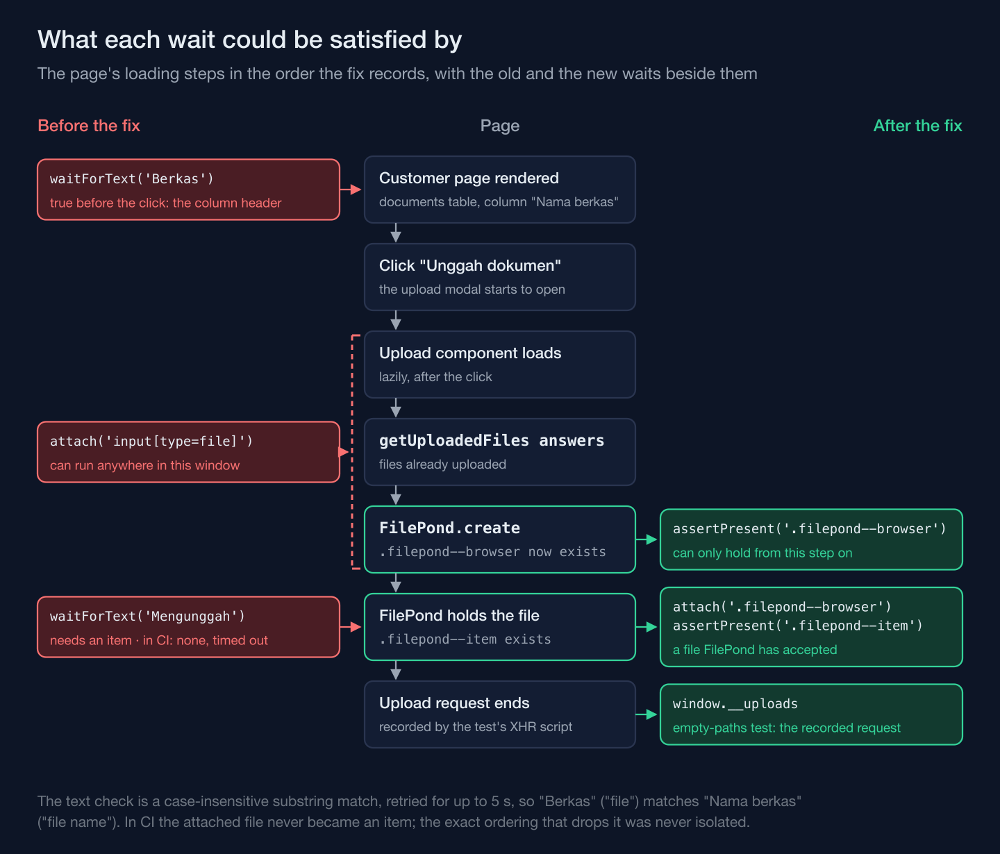
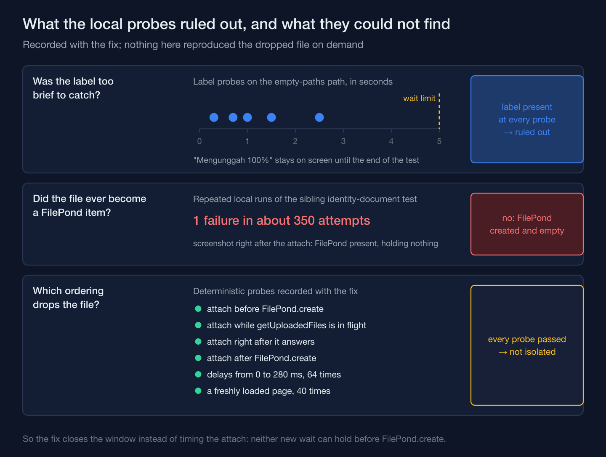

On a training-academy information system I'm building, an admin attaches a customer's identity document through FilePond, the file-upload component the admin panel embeds. One run of the browser test for that flow failed in CI because the word "Uploading" never appeared. The label wasn't the problem. Two steps earlier, the test had waited for a word that was already on the page before the upload modal existed — and a wait that is already satisfied before the thing it guards exists doesn't put anything in order.

## The failure pointed at a label that never leaves the screen

The failing line waited for "Mengunggah", the interface's Indonesian for "Uploading", and gave up when the wait limit ran out. The obvious reading is a label too brief to catch: it appears and vanishes between two polls. That reading didn't survive a local check. This particular test covers a path where the server stores nothing, explained further down, and on that path FilePond shows "Uploading 100%" and a button reading "Uploading file…" until the end. Probes at 0.3, 0.7, 1.0, 1.5 and 2.5 seconds all found the label, and an assertion against the final state passed. A wait that keeps checking for five seconds cannot miss a label that never goes away — as long as FilePond is holding a file.

So in CI the attached file had never become a FilePond item at all. Locally I got the same class of failure once in about 350 attempts, in the sibling test that uploads an identity document, and the screenshot taken right after the attach showed FilePond created and empty.

## The word it waited for was already in a column header

The steps, before the fix:

```php
$page->click('Unggah dokumen')
    ->waitForText('Berkas')
    ->attach('input[type=file]', base_path(UPLOAD_FIXTURE))
    ->waitForText('Mengunggah');
```

"Berkas" means "file", and the wait was meant to show that the upload form had rendered. In the version of the browser plugin this suite runs, `waitForText()` is a deprecated alias of `assertSee()`: a case-insensitive substring match against visible text, retried until it holds or five seconds pass. The customer page already has a documents table, and one of its columns is headed "Nama berkas" — "file name". A DOM probe confirmed the wait matched that header before any modal existed. It returned immediately, so `attach()` could run while the modal was still assembling itself: the lazily loaded upload component, the request for files already uploaded (`getUploadedFiles`), and `FilePond.create`.

The attach went to whatever single element matched `input[type=file]` at that moment. Nothing in that step said whether FilePond had taken over the form yet.

## I removed the race without finding the exact interleaving

The natural next step was to find which ordering drops the file, and I didn't manage it. The deterministic probes attached the file before FilePond was created, while `getUploadedFiles` was in flight, right after it answered, and after FilePond was created; then with delays from 0 to 280 ms, 64 times; then on a freshly loaded page, 40 times. Every one passed. The commit says plainly that the exact interleaving is still not isolated.

That shaped the fix. It doesn't try to time the attach better; it makes the early attach impossible (docblock condensed and translated from the codebase's Indonesian):

```php
/**
 * Attach the fixture to a FilePond that has ALREADY been created, then wait
 * until FilePond holds the file.
 *
 * Sync on stable DOM state, not text: waitForText('Berkas') also matches the
 * "Nama berkas" column heading on the customer page before the modal exists,
 * and the "Mengunggah" label is only a UI symptom. .filepond--browser
 * (FilePond's own input) exists only after FilePond.create: the component has
 * loaded and getUploadedFiles has finished. .filepond--item exists while
 * FilePond holds the file, from queued to finished.
 */
function attachToFilePond(mixed $page): void
{
    $page->assertPresent('.filepond--browser')
        ->attach('.filepond--browser', base_path(UPLOAD_FIXTURE))
        ->assertPresent('.filepond--item');
}
```

The plugin retries `assertPresent()` the same way it retries the text check, so each assertion still works as a wait. What changed is the set of things that can satisfy it. A column header can contain the word "file"; nothing on the customer page except FilePond renders FilePond's own input, and nothing except a file FilePond has accepted renders an item. The attach now goes to that input, not to whatever lone element happened to match `input[type=file]`.



## The progress label was never evidence of the request

The test that failed exists to pin down a limitation, not a feature. The browser plugin serves the application from an in-process HTTP server, and in this version that server only parses URL-encoded bodies: a multipart upload arrives with no files and no fields. The upload endpoint therefore answers 200 with an empty list of stored paths — success, with nothing stored and no error — and FilePond stops at "Uploading 100%". The sibling test runs through a test-only bridge that does the multipart parsing that PHP itself does under PHP-FPM, and expects the document to arrive. The test without the bridge records what happens when it's missing (comment translated):

```php
// The browser sends the file; the Livewire endpoint doesn't receive it and still answers success.
expect($uploads)->toHaveCount(1)
    ->and($uploads[0]['sentFile'])->toBe('dokumen-sintetis.pdf:'.filesize(base_path(UPLOAD_FIXTURE)))
    ->and($uploads[0]['status'])->toBe(200)
    ->and(json_decode($uploads[0]['response'], true))->toBe(['paths' => []])
    ->and(CustomerDocument::query()->where('customer_id', $customer->getKey())->count())->toBe(0);
```

On that path "Uploading" is a symptom of FilePond holding the file, not evidence that the request arrived. The test already had a better witness: a script that records every XHR the page sends with its status and response body, and a loop that polls that record through the plugin's event loop. The fix deleted the label wait and let the recorded request be the synchronization point. The assertions didn't change.

Text waits aren't banned by this. The identity-document test still waits for "Pengunggahan selesai", "Upload complete", before it clicks submit, because there the text is the state that matters: clicking submit before the upload's finishing call (`_finishUpload`) arrives sends the form without the file.



## A green rerun can't prove this kind of fix, so the fix has to be structural

The evidence attached to the change is ordinary: the whole test file six times in a row, five of five each time, and the code style check passing. Two of those five tests go through FilePond, so that is twelve FilePond runs against a failure that showed up about once in 350 locally. At that rate, twelve clean runs is what you would expect even if nothing had been fixed, so the reruns show the change broke nothing and say almost nothing about the flake.

The one check that does carry weight is a mutant: enabling the multipart bridge inside the empty-paths test turned it red. Once the endpoint actually receives the file, the empty-paths expectation can't hold, so after the rewrite the test still detects the one thing it exists to detect. The case for the fix is structural: no text on the page can satisfy the new waits early, so the attach can no longer run before FilePond exists. Whether that early attach was the cause is unproven — the probes that attached before FilePond was created passed too — but if the drop recurs, the test now fails at the item check right after the attach, instead of at a label two steps later.

A wait condition claims that only the state you're waiting for can satisfy it, and on a page that already said "file name", waiting for "file" proved only that the page had loaded.
