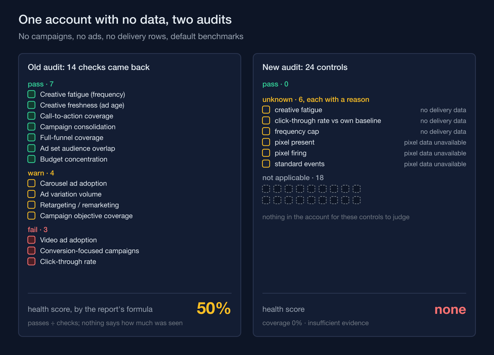
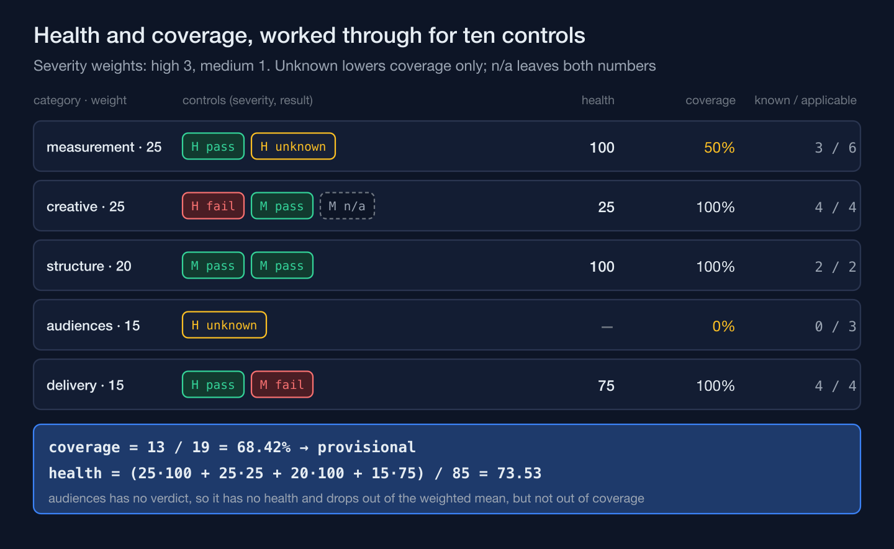

The platform I build for a multi-branch aesthetic clinic chain runs an audit over the client's ad account and prints a health score in the report it sends, on screen and as a PDF. Its first version had no way to say it hadn't seen anything. Run on an account with no campaigns, no ads and no delivery data, seven of the fourteen results it returned were passes, four were warnings and three were failures, and the score the report computes from them is 50%. A health score is only half an answer. The other half is how much of the account the score is about, and the replacement prints both.

## An average of nothing came back as zero, and zero passed

The old checks computed account-wide averages and counts first and judged them afterward, and every one of them fell back to zero when there was nothing to count (condensed):

```ts
const avgFrequency = totalReach > 0 ? totalImpressions / totalReach : 0;
// … creative-fatigue check:
const status: AuditStatus = avgFrequency > 3.5 ? "fail" : avgFrequency > 2.5 ? "warn" : "pass";
```

With no delivery rows, reach is zero, the frequency is zero, and the fatigue check passes with the text "Frequency within healthy range." The same thing happened elsewhere: no active ads meant no ads without a call to action, so call-to-action coverage passed; no campaigns meant nothing to consolidate, so consolidation passed. Running the old checks on an empty account with default benchmarks, and applying the report's own formula to what they return, gives 50%.

The score itself was passes divided by checks, every check counting as one, important or trivial. The report did print active ads, active campaigns, average frequency and click-through rate beside it, but on an empty account those read 0, 0, 0.00 and 0% — zeros that look like measurements, not like absence. The report also labeled its period "Last 6 months" while the data request asked for the last 90 days.



## Four states, and only two of them are verdicts

The replacement gives every control one of four results: pass, fail, unknown, or not applicable. The old "warn" is gone; a borderline observation is meant to be a pass with a note. **Not applicable** means the thing the control is about doesn't exist in this account — no conversion campaigns, so there's nothing for a conversion check to judge. **Unknown** means the control applies but its evidence is missing, and it carries a reason from a fixed list — among them no delivery data, no active ads, a sample too small, a benchmark never observed, and a fetch that failed with a given code.

The runner makes the not-applicable call, and most unknown calls, before any rule runs. It checks the control's precondition first, then each required input in declared order, and only then calls the rule. A rule may still return unknown with its own reason, a sample too small for instance, but never not applicable: a rule that tries throws, because that verdict belongs to the runner. The averages are now null instead of zero (comment condensed from the code):

```ts
// Each mean is null when its denominator is zero — NEVER 0. A zero here is
// the mechanical root of an empty account reading as healthy.
const avgFrequency = totalReach > 0 ? totalImpressions / totalReach : null;
```

The null alone doesn't do all the work: two frequency rules still read it back as zero. What protects them on an empty account is the required-input check, which makes any control that needs delivery data unknown before its rule runs.

The comparisons changed less than the states did. The fixed click-through-rate benchmark the old rules used is gone; click-through rate is now compared with the same account's previous 90-day window and comes out unknown when either window has fewer than 10,000 impressions. The frequency and campaign-count cut-offs stayed, as named constants each labeled practitioner judgment. The one control that compares the account with its competitors resolves to unknown, reason "benchmark not observed," when the competitor data doesn't contain the value it needs — which, as the change shipped, is always — and at informational severity it moves neither number.

## Health and coverage come from one function, in two numbers

Each control has a severity, weighted 5 for critical, 3 for high, 1 for medium and 0 for informational. Inside a category, health is the passing weight divided by the weight that has a verdict, and coverage is the weight that has a verdict divided by the weight that applies. Unknown never enters the health formula; it only lowers coverage, and enough of it pushes coverage low enough that there is no health number at all. Not applicable leaves both denominators. The five categories carry fixed weights — measurement 25, creative 25, structure 20, audiences 15, delivery 15 — and the engine throws if they don't add up to 100. Overall health is the weighted average of the categories that have one. Overall coverage decides the label: 80% or more is graded, 60% or more is provisional, and below that the audit has insufficient evidence and prints no health number at all.

That function is the only place either number is computed. The two renderers display what it returns and are not allowed to divide anything again, which is how the on-screen report and the PDF stay in agreement.



On the empty account the new controls return no passes at all: six unknown, eighteen not applicable, coverage 0%, no health score, insufficient evidence. A fixture report rendered through the new path shows why the second number has to sit next to the first: overall health 79 and coverage 83%, graded, while its measurement category reads health 100 on 42% coverage. A perfect category score on less than half the evidence is the kind of number a single score shows without comment.

## The plan was reviewed before any code ran, and the review found the plan defeating its own goal

The work was planned before it was built, and the plans went through two review rounds first. Twenty-five findings survived an attempt to refute each one, and eighteen didn't. A separate audit of the first round's fixes then caught seven problems those fixes had introduced. The finding that mattered most for this article was about the only critical control in the registry, the one that checks whether conversion campaigns record any conversions. As planned, its precondition read spend from the delivery data while declaring campaigns as its input. Preconditions run before the missing-input check, so an account with conversion campaigns and no delivery rows would have come out "not applicable" — the single critical control dropping out of both denominators in exactly the case the change existed to fix: an account that has campaigns but no delivery data yet. The precondition now looks at campaigns only. With no delivery rows, the missing-input check makes the control unknown, and rows with zero spend make its rule return unknown; either way it stays in the coverage denominator and is listed among the critical controls that couldn't be judged.

The same review found that the scoring function checked the join between controls and results in one direction only. A control with no result would have quietly left both denominators, which could have pushed coverage up. It now throws either way:

```ts
const result = resultById.get(def.id);
if (!result) {
  throw new Error(`scoreAudit: no result for registry control "${def.id}"`);
}
```

## A pattern of unsourced claims is banned by a test, not by a style note

The old checks also wrote advice into the report. The planning record singled out seven sentences that stated unsourced figures or claims as fact, and all seven were rewritten. The new registry is guarded by a test that fails if any of its static text matches this pattern:

```ts
const FOLKLORE_REGEX =
  /\d+\s*[–-]\s*\d+\s*(×|x|%|pp)|\d+\s*(×|x)\s+(more|the rate)|industry benchmark|best practice/i;
```

The pattern catches four of those seven sentences; the other three were removed by the rewrite and confirmed gone by a one-off search, not by the standing test. Numbers the audit actually observed are kept in each result's evidence and written into its observation text when the rule runs, which is why a sweep of static strings alone could never see them. As planned, the sweep looked at static strings and at the output of a single snapshot, and the review pointed out that the old claims had lived in failure branches a single snapshot never takes. The sweep now covers every observation, competitor note and recommendation produced in the evaluator's tests.

An audit that can't say how much it saw will report what it didn't see as health, and the fix is a second number beside the first, not a better first number.
