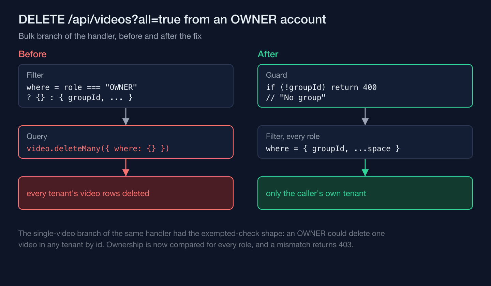
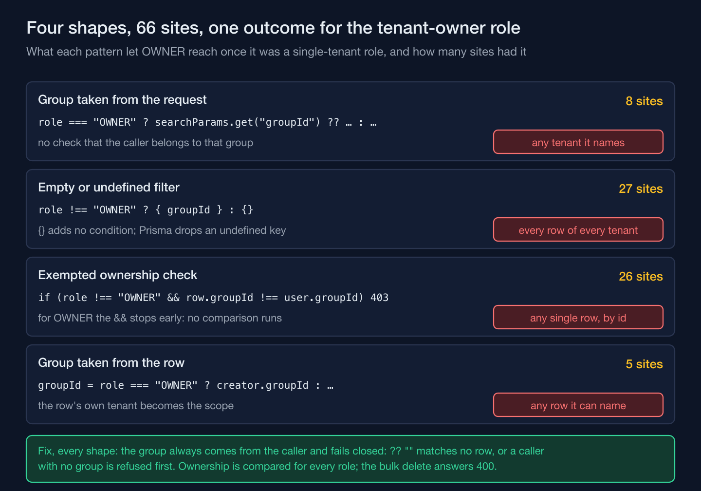

A Prisma `where` clause has exactly two states that matter for tenant isolation: it filters, or it doesn't. There's no third state where an empty object is "sort of" a filter — spread into a `where`, `{}` adds zero conditions, and a query with zero conditions matches every row in the table. On a social-media intelligence platform I build for a multi-branch aesthetic clinic chain, that distinction turned out to be the shape behind a security sweep across the whole API: one elevated role had been narrowed from platform-wide to single-tenant in an earlier redesign, and sixty-six call sites in four shapes still ran on its old, unscoped meaning.

## A role split in two, and most of the old code didn't notice

The role in question — call it the tenant-owner role — used to be the platform operator. Early on, giving it reach across every tenant was correct, because it was the only role meant to work across tenants. A later redesign introduced a second role as the only one with legitimate cross-tenant access, and narrowed the original role to its own tenant. The redesign ran its own sweep and closed a handful of the old cross-tenant branches, but nothing in the codebase made it find all of them. The rest kept compiling, kept passing their existing tests, and kept doing exactly what they had always done — which was the problem.

## The dominant shape wasn't a missing check, it was an empty object

The main pass of the sweep found the dominant pattern and its `undefined` sibling at twenty-two sites, almost verbatim, and the final pass found five more:

```ts
// the dominant shape, with its undefined sibling — 22 sites in the main pass, 27 in the end
const groupFilter = user.role !== "OWNER" ? { groupId } : {};
// ...spread into a Prisma `where`; {} adds no conditions, so it matches every row
```

A sibling shape did the same thing through a different mechanic: `groupId: user.role !== "OWNER" ? user.groupId : undefined` — Prisma treats a key whose value is `undefined` as if it weren't there, so it adds no condition and the effect was identical. Most of these were correct when they were written: the override was deliberate for as long as the role meant "platform operator," and it became a bug the moment the role's scope narrowed. Not all of them were that old, though. Three weeks after the split, a fix that tightened tenant scoping on a group of routes added four new copies of the old filter to the handlers it touched.

The worst instance of the shape sat behind a single query parameter. A bulk-delete handler built its filter as `user.role === "OWNER" ? {} : { groupId, ... }` and handed it straight to `prisma.video.deleteMany`. An empty `where` matches every row, so `DELETE /api/videos?all=true`, called by anyone still holding the tenant-owner role, deleted the video library of every tenant on the platform in one request — no group id required, and nothing in the request that distinguished "delete my tenant's videos" from "delete all of them." The fix scopes the filter unconditionally and refuses the request outright if the caller somehow has no group of their own, specifically so the filter can never silently fall back to matching everything again.



## A guard that always passes is not a guard

A second shape was quieter but followed the same logic. Twenty-six by-id handlers checked ownership with `if (user.role !== "OWNER" && row.groupId !== user.groupId) return 403`, which exempts the tenant-owner role from the ownership check entirely — any row, by id, in any tenant. A fourth shape went a step further: it skipped the check for the role, then took the group for every later read or write from the row itself rather than from the caller, so whichever tenant owned the row became the scope. The code read like a guard and executed like a no-op, and nothing about its syntax — valid TypeScript, a real conditional, a real 403 branch — gave that away.



## The sweep that reported "zero remaining" still had seven sites open

Part of the fix for the dominant shape was a small rewrite script, and it closed the sites it matched correctly. The pass then reported the shape as fully closed. The claim was wrong, and the way it was wrong is the more interesting failure. The rewrite script's pattern match was sensitive to indentation: it caught the spread written at 6- and 8-space indentation and silently skipped five sites in another part of the API — four of the same spread at 4-space indentation and one written across several lines. "Zero remaining" had been read off the truncated tail of a scan's output, not verified against the code.

Two more sites, found in the same follow-up pass, were resolvers that looked up a space by id and took its group from the row they found — the fourth shape, which the same pass had also reported closed. One of them carried a comment stating the original intent outright — the tenant-owner role "can hit any space" — above a lookup filter built exactly the way that comment described. The comment was accurate when it was written and wrong the moment the role's scope narrowed, and nothing about a code comment ages automatically with the permission model it describes — it just sits there, true until it isn't, with no mechanism to flag the gap. The final tally, by shape: 8 handlers that took a group id verbatim from the query string or the body, 27 empty-object or `undefined` filters, 26 ownership checks that exempted the role, and 5 that took the group from the row being accessed — sixty-six sites, against the two an earlier pass had recorded. The correction that fixed this didn't trust the rewrite script's count a second time: it came from manually enumerating every remaining occurrence of the role check in the API tree and reading each one, which is slower than re-running a scanner and is also the only way that would have caught a scanner with a blind spot in its own pattern.

## Closing the gap meant failing closed, not reverting to the old default

The group id on a user account in this system is nullable — the schema always anticipated an account with no tenant attached — and the session's group id is optional. That meant the obvious-looking fix, `{ groupId: user.groupId }` with no further condition, would have reintroduced the same leak for exactly that edge case: an absent group id arrives as `undefined`, and Prisma drops the key. Every fix fails closed instead. The filters either fall back to an empty-string group id that no row has or refuse a group-less caller before querying, the by-id ownership checks stop matching any row and return 403, and the bulk delete refuses with a 400 before its query runs. It's a narrower fix than it looks: a group-less account that used to see every tenant now sees none, not its own, because there is no "own" to fall back to.

The same sweep deliberately left two other patterns untouched, even though they matched the same grep. Seven branches — role gates deciding which actions a role may take inside its own tenant, and permission bypasses for uploads and deletes that never leave that tenant — read as superficially identical to the isolation bugs but encode a different kind of decision — who gets to do what, not whose data they can reach. Folding those into the same pass would have changed permissions nobody had asked to revisit, under the cover of a security fix that was supposed to be about tenant boundaries and nothing else.

A sweep's "zero remaining" is a claim about the scanner as much as the code, and it only counts once the scanner has been rerun to zero and every survivor has been read by hand.
