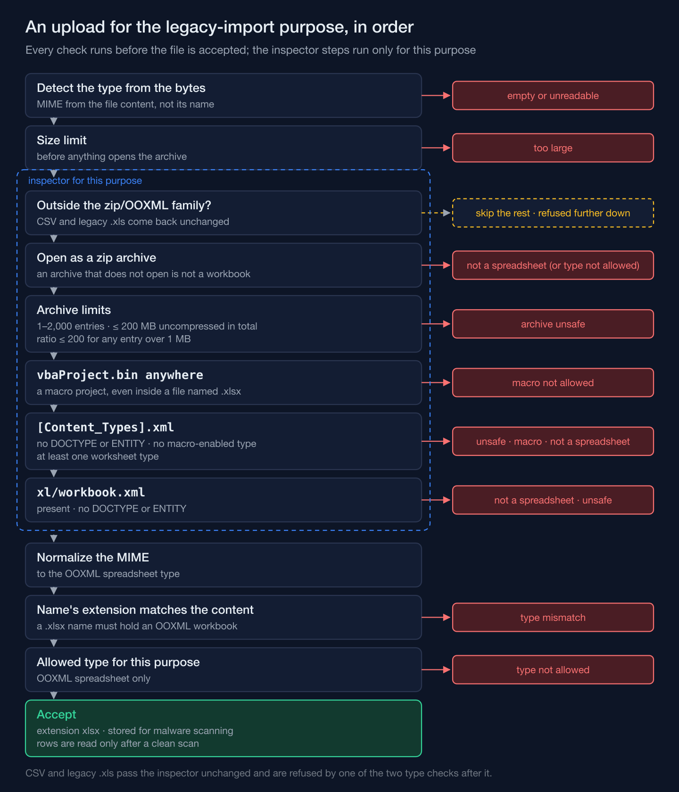
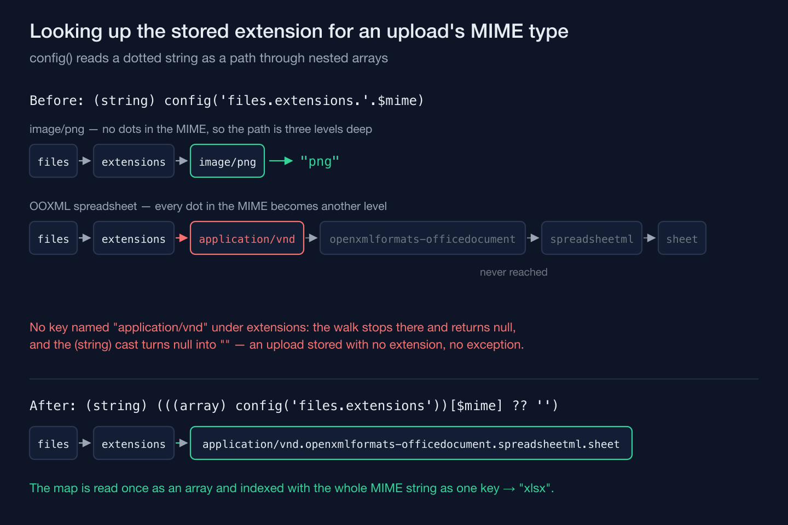

A bulk-upload path doesn't get to trust a file just because its filename ends in `.xlsx`. On a training-academy information system I'm building, the pipeline that turns years of spreadsheet-kept student records into real database rows treats every uploaded workbook as hostile until it's proven otherwise — and "otherwise" turns out to mean four separate checks before a single cell gets read, plus one near-miss in the plumbing that had nothing to do with spreadsheets at all.

## An .xlsx file is a zip archive wearing a disguise

The modern Excel format isn't really a binary blob — it's a **zip archive** holding a set of XML parts, one per sheet plus some shared metadata. That means every one of the attack surfaces that come with "arbitrary zip file from a stranger" apply the moment someone uploads one, before a single formula gets evaluated.

The upload path can attach an inspector to each upload *purpose*. The purpose for legacy data imports has one (the purpose for attaching an old certificate scan doesn't need it), and it runs right after the file-size limit check and before the file is accepted anywhere durable. For the zip/OOXML MIME family specifically, the inspector opens the archive and runs four kinds of check (the figure below shows the exact order):

- entry count, the total uncompressed size, and the compression ratio of any large entry, so a small upload can't unzip into gigabytes on the server — the standard defense against a **zip bomb**;
- whether a macro project is present (a `vbaProject` part, or a macro-enabled content type) — rejected outright, no macro-bearing workbook is ever parsed any further;
- whether the archive's content-type manifest declares at least one worksheet part, and a workbook part is present — if not, it's not a spreadsheet, rejected;
- whether either XML part it reads — the archive's content-type manifest and the workbook part — declares a `DOCTYPE` or an `ENTITY` — rejected, because that declaration is the door an **XXE** (XML external entity) attack walks through.

Only once all four pass does the file's MIME type get normalized to the canonical OOXML type. A plain CSV or a legacy binary `.xls` (OLE) upload skips this path entirely — it was never a zip archive in the first place, so there's nothing to open and nothing to normalize — and is then refused anyway, because this upload purpose accepts only OOXML workbooks (as a type mismatch if it was renamed to `.xlsx`).



## The MIME type that just earned your trust can still defeat the next lookup silently

Here's the part that isn't about spreadsheets at all. Once a file's MIME type has been normalized, the pipeline needs to look up the file extension it should be stored under, keyed by that MIME string. The natural way to write that lookup in a Laravel codebase is through the `config()` helper, which resolves nested configuration values using dot-separated paths — `config('files.extensions.image/png')` reads as "the `extensions` array, under the `files` config file, at key `image/png`."

The trouble is that an OOXML MIME type is itself full of dots. `application/vnd.openxmlformats-officedocument.spreadsheetml.sheet` reads as one continuous identifier to a person, but handed to `config()`'s dot-splitter as part of a key path, it looks like several levels of nested array traversal:

```php
// Reads fine for 'application/pdf'. For an OOXML MIME type, config() splits
// the appended key at every dot and walks nested arrays that don't exist.
$extension = (string) config('files.extensions.'.$mime);
```

Every MIME type the system had accepted until then — JPEG, PNG, PDF — had no dots in it, so the line had always worked. The net effect, which a read of the code while planning this work turned up before any dotted MIME had been added: a MIME value with dots doesn't raise an error when it fails to resolve to an extension. `config()` returns `null` for a path that leads nowhere, and the `(string)` cast turns that quietly into an empty string. A file that had just survived a zip-bomb check, a macro check, a worksheet check, and an XXE check could then get written to storage with no file extension recorded at all — and nothing downstream would ever throw to tell you.

The fix doesn't lean on `config()`'s dot-parsing for this lookup at all: it resolves the extensions map once as a plain array and indexes into it directly, so a MIME type is never mistaken for a path through several levels of nested config.

```php
// Resolve the map once, then index it with the MIME string as one flat key.
$extension = (string) (((array) config('files.extensions'))[$mime] ?? '');
```



Nothing about the four archive checks changes. The fix is one layer downstream of them, in code that has no idea what a worksheet is — which is exactly why it was the kind of bug that wouldn't have shown up by thinking harder about spreadsheet security and would have shown up by reading the actual line.

## Trusting a parsing library's own defaults is still a decision

The workbook reader that runs after a file clears every check doesn't take its underlying library's behavior as given, either. One deliberate deviation: a formula cell that has no cached calculated value — an `<f>` element with no accompanying `<v>` — reads back as empty, not as zero, which is what the base reading library does by default.

That sounds like a rounding error until you picture the actual input: a years-old spreadsheet, opened once in some stripped-down tool that saved it without recalculating formulas, carrying a column of historical payment or attendance figures. Treating a missing cached value as a real zero would silently rewrite that cell's history — a number nobody ever entered, now indistinguishable from one that was legitimately zero. Reading it as empty routes the row into the pipeline's existing "we don't know this value" handling instead of inventing a fact.

The same reader keeps hidden sheets in play, because legacy spreadsheets hide data on purpose and a migration that silently drops a hidden sheet is a migration that silently drops data. But it never follows external links that a workbook's XML can reference — an uploaded file doesn't get to make the server reach out to some other resource as a side effect of merely being opened. Two edges of the same principle: the library's defaults are a starting point for a decision, not a substitute for making one.

All of it is pinned down by tests that assert one row of the classification table at a time — the archive normalizes and passes, the macro-bearing file is rejected, the file with no worksheet is rejected, the file with a `DOCTYPE` is rejected, the file over the entry or size limit is rejected, the plain CSV and OLE files end up refused as a type this purpose doesn't accept — plus a slice of the broader ingestion suite, a clean static-analysis pass, and a clean style check, all green before any of it was committed.

The upload that should worry you least is the one your scanner rejects loudly — it's the one that quietly resolves to an empty string and gets filed away anyway.
