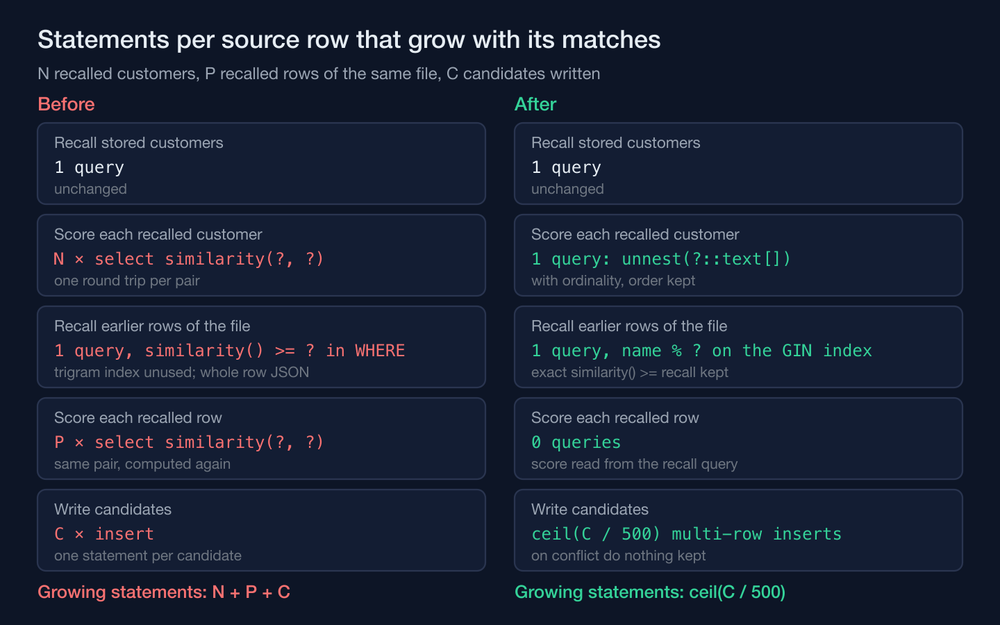
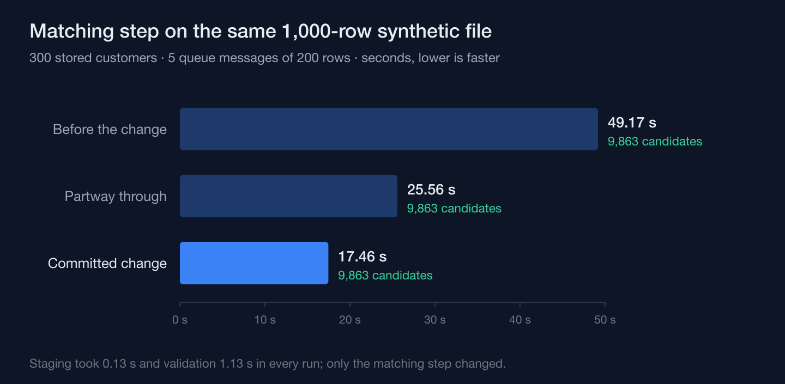
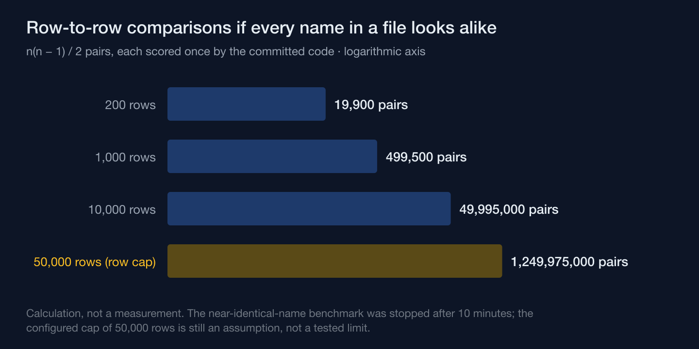

The duplicate-matching step of a spreadsheet import took 49.17 seconds on a 1,000-row file and, after one change, 17.46 seconds — and both runs proposed exactly 9,863 candidate matches. None of that time had gone into the trigram math. It went into the statements wrapped around it: one database round trip for every pair scored, a recall filter that hid the trigram index behind a function call, the same pair scored twice, and one `INSERT` per candidate. The change rewrote all of that and none of the scoring, and the number that tells you it was a performance change rather than a behavior change is the one that didn't move.

The system is a training-academy information system I'm building, and the import exists to bring its spreadsheet-era history into a customer database that treats identity as the thing it must never get wrong. Every row of an uploaded file is checked twice: against customers already stored, and against earlier rows of the same file, because one person can appear more than once in the same workbook. PostgreSQL's `pg_trgm` is the only similarity engine in the codebase — the repository class says so in its own docblock — and a pair is recalled for scoring when its names reach a similarity of 0.225, half the 0.45 the scorer needs before a name counts as evidence.

## One similarity score per query is one round trip per pair

The sweep that scores a row against recalled customers looked like the obvious code. Recall the candidates, then loop over them and ask the database for each pair's similarity. Every iteration was a `select similarity(?, ?)` — a full round trip through the driver to compute one float. A row that recalled forty customers would have paid forty trips before any of the evidence rules ran.

The replacement hands the database every recalled name at once and gets every score back from one statement:

```sql
-- All N recalled names in one statement. ORDINALITY keeps each score at its input
-- position, so the caller indexes results by position instead of re-matching by name.
select case when r.name = '' then 0 else similarity(?, r.name) end as value
from unnest(?::text[]) with ordinality as r(name, position)
order by r.position
```

The `case` is not decoration. The single-pair helper it replaced returned `0.0` without querying whenever either name was empty, so that zero was a rule of the PHP code, not of the database. The batch version reproduces it in SQL for an empty right-hand name and short-circuits an empty left-hand name before any SQL runs. Without that, the same engine on the same inputs could still have disagreed with the old code on exactly the rows a messy legacy file is full of: the ones with a blank name cell.

## An index cannot serve a filter it does not recognize

The second recall — earlier rows of the same file — was slower for a different reason. Its `WHERE` clause said `similarity(k.name_normalized, ?) >= ?`, and the match-key table it ran against had a GIN trigram index on that very column, created with the table. The index never helped. PostgreSQL's documentation for `pg_trgm` lists what its GIN and GiST operator classes support: the similarity operators, plus trigram searches for `LIKE`, `ILIKE`, `~`, `~*` and `=`. A function call compared with `>=` is none of those, so each row's name was scored against every earlier row of the file, index or no index.

The fix filters with the operator the index understands and keeps the real rule beside it. Condensed from the query builder, with the join that reads the payload left out:

```sql
-- Transaction-local: set_config(..., true) reverts at commit, so nothing else on this
-- pooled connection inherits the matcher's threshold.
select set_config('pg_trgm.similarity_threshold', '0.224', true);

select k.row_id, similarity(k.name_normalized, :name) as name_similarity
from import_row_match_keys k
where k.job_id = :job and k.mapping_version = :version and k.row_id <> :row
  and (
        -- % is the index's operator, and it means "greater than" the threshold;
        -- the threshold sits a hair under the rule so the prefilter is never stricter.
        (k.name_normalized % :name and similarity(k.name_normalized, :name) >= 0.225)
     or k.contacts && :contacts    -- a shared contact still recalls, whatever the name
  );
```

That `0.224` is where this change could have quietly broken matching. The documentation defines `%` as true when the similarity is *greater than* `pg_trgm.similarity_threshold`. The rule the matcher has always applied is *at least* 0.225. Set the threshold to exactly 0.225 and a pair sitting precisely on the boundary — rare, but a value a real pair can produce — passes the old filter and fails the new one. So the threshold goes in at the recall value minus 0.001, the operator only ever narrows the search to a superset, and the exact `>=` decides. The setting is scoped with `set_config`'s `is_local` flag, which the documentation says applies "only during the current transaction" — the matcher's threshold dies with its transaction instead of following a pooled connection into someone else's query.

## The same score was computed twice and written one row at a time

The old peer recall computed each pair's similarity inside its `WHERE` clause and then threw it away. The comparison step that followed called the single-pair helper again for the same two names — a second round trip for a number the database had just produced. The recall query now selects the score it filters on, and the comparison accepts it as an optional argument; called without one, it behaves exactly as before. The batched scoring from the first section also lives in the sweep that the ordinary duplicate scan of stored customers uses, so that path got faster too, through the same code.

The old query also fetched each recalled row's whole normalized payload, a JSON document per row, so that four fields could be read out of it in PHP. The new one extracts those four paths in SQL. And candidates, which were inserted one statement at a time — two per row-to-row match, one for each direction — are now buffered for the source row and flushed at the end of its transaction, 500 to a statement, still as `INSERT … ON CONFLICT DO NOTHING`, so the partial unique indexes remain the only thing that decides what counts as a duplicate candidate.



Put side by side, the old code issued N + P + C statements per source row on top of its fixed queries; the new code issues one insert per 500 candidates. None of the boxes in the right-hand column changed what gets scored or how.

## 9,863 is the number that makes it a refactor

The measurement ran from a temporary test that was deliberately never committed: 1,000 synthetic rows with varied names, 300 stored customers, five queue messages of 200 rows each. Staging took 0.13 seconds and validation 1.13 in every run, so the matching step was the whole story. It went 49.17 → 25.56 → 17.46 seconds as the pieces went in.



The green labels matter more than the bars. In a system whose core promise is one stable identity per customer, a matcher that gets faster by proposing fewer candidates hasn't been optimized — it has started hiding duplicates from the person whose job is to merge them, and nothing downstream would complain. So the same count across all three runs was the first check, and the second was the regression suites around it: 103 tests across duplicate detection, merging, manual registration, registration review and the candidate preview, ten unit tests of the scoring, and 36 import tests, including a fixture that pins which of its pairs must come out as strong matches and which as weak ones. A count can stay equal while its contents shift; the pair fixture is what rules that out for the cases it covers.

## The benchmark's first file never finished, and the fix doesn't change why

The first measurement didn't use varied names. It used near-identical ones, the worst case, and it did not finish within ten minutes; it was stopped by its process id and the benchmark was rerun with varied names. The reason is in the recall threshold. At 0.225, names that look alike recall each other, and when every name in a file looks alike, every row recalls every earlier row.



The change cut the cost of each pair. It did nothing to the number of pairs, which in that case is n(n − 1)/2: half a million for a thousand rows, over a billion at the 50,000-row cap the import is configured with. The phase's own summary says as much in its limitations: 17.5 seconds per 1,000 rows on a synthetic spread is not evidence for large files, clusters of common names grow quadratically, the row cap is an assumption, and the matcher gets measured again on the staging dataset before any pilot. That paragraph is the most useful thing the benchmark produced, because it is the one finding the fix didn't make go away.

A faster query is the easy half of a matcher change; the half that counts is showing it still finds the same 9,863 candidates.

---

## Sources

- PostgreSQL — *F.35. pg_trgm — support for similarity of text using trigram matching, version 18* (the `%` operator is true when similarity is greater than `pg_trgm.similarity_threshold`; the GIN and GiST operator classes support the similarity operators plus `LIKE`, `ILIKE`, `~`, `~*` and `=`). Retrieved 2026-10-29. <https://www.postgresql.org/docs/current/pgtrgm.html>
- PostgreSQL — *9.28. System Administration Functions, version 18* (`set_config` with `is_local` set to true applies only during the current transaction). Retrieved 2026-10-29. <https://www.postgresql.org/docs/current/functions-admin.html>
