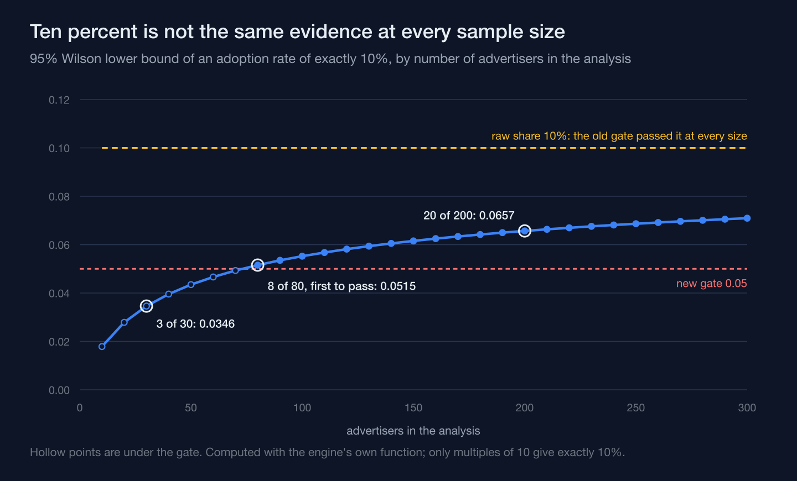
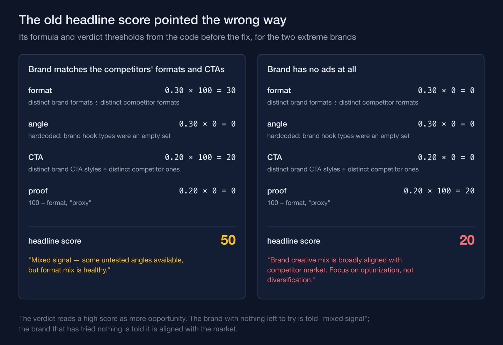

A competitive-gap scoring engine I built for a multi-branch aesthetic clinic chain compares the creative patterns competitors run — formats, hooks, calls to action, kinds of proof — with the brand's own ads, and reports where competitors crowd a pattern the brand hasn't tried. Its first version let a pattern into that report once a tenth of competitor ads used it. Three ads out of thirty cleared the gate exactly as thirty out of three hundred did, and only one of those numbers is evidence of anything. When I went back to fix the gate, it turned out to be the smallest of the engine's problems.

## The sample-size term never varied inside one analysis

The first version scored each pattern like this (condensed):

```ts
// Opportunity: competitor pct >= 10%, brand pct <= 5%
for (const [v, cCount] of compBuckets.entries()) {
  const cPct = cCount / totalC;
  const bPct = (brandBuckets.get(v) ?? 0) / Math.max(brandAds.length, 1);
  const gapScore = (cPct - bPct) * Math.sqrt(totalC);
  if (cPct >= 0.10 && bPct <= 0.05) {
    opportunities.push({ value: v, gapScore: n(gapScore), competitorPct: n(cPct), brandPct: n(bPct) });
  }
}
```

`totalC` is the number of competitor ads in the whole analysis, the same for every pattern in it. The gate never looked at that score at all: it was two raw thresholds on the shares. And because multiplying by a positive constant doesn't change any ordering, the sort, the top-five cut and the choice of which briefs to write were decided by `cPct - bPct` alone. The report's PDF methodology described this formula as "sample-size weighted to avoid false positives from low-volume patterns". It wasn't weighted by anything that varied.

It also counted ads, not advertisers. One advertiser running forty variants of an ad could carry a pattern past the 30% line for a critical brief on its own, and the same ad collected by two searches was counted twice. The brief text then said "X% of competitors use…", which was wrong on its face.

## The audit traced every number before any formula changed

The audit that started this listed nine findings against the code, each pinned to a file and line, and each re-checked by a second pass whose job was to refute it: six held as stated and three held with corrections. The fix was split into three blocks, and the decision record put the data first in plain terms — do this block first, because scoring without it is pointless. Every engine and fetcher bug described below was already in the engine's first commit, and all of them survived about two and a half months, until the audit.

## A brand's own ads were scored without ever being measured

The brand side of every comparison was built from a cached campaign report whose ad entries carried no creative metadata. The fetcher filled the brand's format and call-to-action fields with empty strings, hardcoded, one of them next to a comment saying it wasn't in the cache. Downstream, an empty format became "single image" and an empty call to action became "none", so the brand's mix in all nine dimensions was invented. Six of the nine dimensions had no brand mapping at all, so the brand's share there was always zero, and every competitor pattern above ten percent came out as an opportunity automatically.

A real zero and an unmeasured zero produce the identical number. That's the problem: nothing downstream could tell "we checked, and the brand has none of this" from "we never checked." The brand's ads now come from its own stored creatives and go through the same pattern extraction and scoring as the competitors'. Every dimension now carries the brand's coverage flag, set once for the whole analysis. With no brand creatives it's unmeasured: the whitespace term becomes a labeled, neutral 0.5 instead of an assumed zero share, the briefs about video and call-to-action variety don't fire at all, and the proof brief reports the brand's proof coverage as "unmeasured (no tracked ads)" rather than as a number.

## The population behind every percentage was pre-filtered for quality

The competitor fetcher capped its result at 500 ads ordered by final score, highest first. Whenever the searches behind an analysis held more competitor ads than that, the 500 rows that came back weren't a sample of the market; they were its 500 best-scoring ads. Every count of how many competitors use a pattern was taken over a population already filtered for whatever the scoring rewarded, which inflates the measured adoption of anything correlated with a high score. Ordering the same query by start date, newest first, turns the cap into a recency window instead of a leaderboard. Competitors are also deduplicated now, by page and ad ID, falling back to the row ID because the ad ID defaults to an empty string.

## Ten percent of thirty advertisers is not ten percent of two hundred

With honest inputs, the gate itself could change. Adoption is now counted per advertiser, as distinct pages, and the gate reads it through a 95% Wilson lower bound instead of at face value:

```ts
export function wilsonLowerBound(k: number, n: number, z = 1.96): number {
  if (n <= 0 || k <= 0) return 0;
  const p = Math.min(k / n, 1);
  const z2 = z * z;
  const center = p + z2 / (2 * n);
  const margin = z * Math.sqrt((p * (1 - p)) / n + z2 / (4 * n * n));
  return Math.max(0, (center - margin) / (1 + z2 / n));
}
```

A pattern enters the report only when that bound is at least 0.05. Three advertisers out of thirty is ten percent, and so is twenty out of two hundred, but `wilsonLowerBound(3, 30)` is about 0.0346, under the gate, while `wilsonLowerBound(20, 200)` is about 0.0657, over it. The margin term is largest when the sample is small, so the same label, "ten percent of advertisers," reads as noise in one case and as a signal in the other. At exactly ten percent, the first analysis size that clears the gate is 80 advertisers.



## A thin sample needs a prior, not its own raw average

Clearing the gate only means a pattern is worth scoring; it says nothing about how much to trust that pattern's quality number. That number used to be the plain average of its ads' scores, the same arithmetic for two ads as for twenty. It is now pulled toward the analysis's overall mean until there's enough weighted evidence to move it:

```ts
const QUALITY_PSEUDO_COUNT = 5;
// for each of the pattern's ads, summed into wSum and wScore:
const conf = Math.min(Math.max(m.scoreConfidence, 0), 100) / 100;
const longevity = 0.5 + 0.5 * (Math.min(Math.max(m.daysActive, 0), 90) / 90);
const w = conf * longevity;
// then, once per pattern:
const quality = (QUALITY_PSEUDO_COUNT * priorMean + wScore) / (QUALITY_PSEUDO_COUNT + wSum);
```

No ad weighs more than 1, and a full-confidence ad launched today weighs half that, so the pseudo-count stands for five fully weighted ads at the market's mean. With a mean of 50, one full-weight ad scoring 95 gives the pattern a quality of 57.5; twenty of them give 86. Add real evidence and the prior's share falls on its own, with no separate rule to switch the shrinkage off. The pattern's score then multiplies four parts — validation, quality, the brand's whitespace and a factor for how many of the pattern's ads sit in the high-quality cluster — so a validation, quality or whitespace near zero pulls the whole score toward zero.

## A scorecard that points backwards still returns a number

The report's headline score had its own problems. The format and call-to-action terms were ratios of how many distinct formats and call-to-action styles the brand used to how many the competitors used, without checking they were the same ones, so higher meant the brand already covered more, and the raw value could pass 100. They were summed into an overall score that the verdict read as "higher means more opportunity." The angle term was hardcoded to zero, because brand hook types were an empty set, and the proof term was 100 minus the format term, commented as a proxy:

```ts
// Brand hookTypes / proofTypes are not directly mapped, so they stay 0
const brandHookTypes = new Set<string>();

const formatGap = n(100 * brandFormats.size / Math.max(compFormats.size, 1));
const angleGap = n(100 * brandHookTypes.size / Math.max(compHookTypes.size, 1));
const ctaGap = n(100 * brandCtaStyles.size / Math.max(compCtaStyles.size, 1));
const proofGap = n(100 - formatGap); // proxy: less format variety = less proof variety
const overall = n(0.30 * formatGap + 0.30 * angleGap + 0.20 * ctaGap + 0.20 * proofGap);
```

Worked through, a brand whose formats and call-to-action styles exactly matched the competitors' scored 50 and was told "Mixed signal — some untested angles available, but format mix is healthy." A brand with no ads at all scored 20 and, unless two critical briefs short-circuited the verdict, was told its creative mix was "broadly aligned with competitor market. Focus on optimization, not diversification." The proof brief had a separate inversion: it checked `brandAds.length === 0` as "the brand has proof," so it fired whenever the brand had any ads at all and competitors leaned on proof, and the brand most obviously without proof, one with no ads, was the only case it stayed silent for.



All four terms now use one function, 100 times the share of competitor values the brand doesn't use, and with brand data measured, the hook and proof terms can be computed instead of assumed. The headline score is the mean of the top five pattern scores, and one set of bands replaces two: the page had used 70 and 40 while the PDF and the verdict used 60 and 30. The regression tests pin both directions: a brand matching every competitor format, hook and call to action must score under 40, and a market where nine of ten advertisers share a format the unmeasured brand lacks must score 40 or more. Another test checks that a pattern used by one advertiser in thirty never reaches the report, and another that two runs on the same input produce byte-identical output. The hand-calculated values matched the engine on the first run.

A gate, a sample, an input and a scorecard can each be wrong without anything failing, and the only check that catches all four is one that asks where every number came from.
