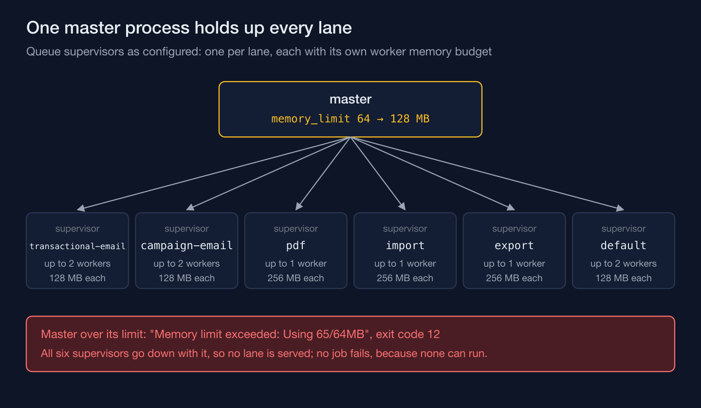
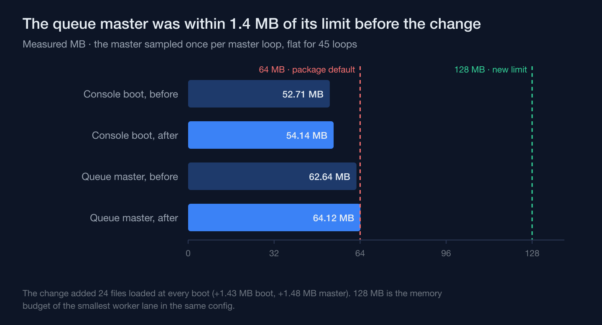

A process that exits for exceeding its memory limit isn't obligated to be leaking. On a training-academy information system I'm building, still pre-production, a queue master went over its configured memory ceiling and exited — and the honest first instinct, go hunting for the allocation that never gets freed, would have been the wrong investigation to open. Measuring before touching any config found something less dramatic and more durable: the process had been living within a sliver of that ceiling long before the change that got blamed for the crash ever shipped.

## The crash took out every lane, not one job

The queue backend is Valkey, and the resilience test that caught this queues a heartbeat job on every lane, starts a real queue master, and waits for each lane's supervisor to process its heartbeat. On this run, none did. The Horizon master printed `Memory limit exceeded: Using 65/64MB`, then exited with status 12 — and all six lanes were left with no supervisor at all.

The six heartbeat jobs the test had queued simply never ran: nothing retried and nothing failed, because no worker ever picked them up. That's the part worth sitting with: the process whose job is to keep every lane's supervisor running was the thing that went missing, so nothing was left to process the queue, and the queue itself raised no error. Only a check outside the job path — the queue's status command, or this system's lane heartbeats going stale — shows the difference between a quiet queue and a dead master.

## Measure the boot, not just the crash

Before accepting "it's a leak," I measured instead of guessing — same CLI invocation with opcache off, same environment the test suite itself runs under, same Valkey backend, sampled repeatedly.

Two numbers mattered. First, the console kernel's own boot footprint: before the change under suspicion, it sat at 52.71 MB; after, 54.14 MB. The difference tracked to twenty-four extra files permanently registered at boot — the new import module's provider and its queue handlers, its admin-panel resource classes, and one translation file. None of that is a defect; it's just more code that exists now and has to be loaded every time the process starts.

Second, and more telling: the Horizon master's own memory, sampled once per master loop, held at 62.64 MB before the change and 64.12 MB after — and then stayed flat there for forty-five consecutive rounds. That flatness is the opposite signature of a leak. A leak climbs round over round, a little more retained each time, until something gives. Between the two versions the master differed once, by about 1.5 MB — nearly all of it (1.43 MB) the extra boot weight the diff accounts for — and within each run it didn't climb at all.

## The ceiling had no headroom left to give away

The 64 MB limit wasn't a number anyone in this project had sized. It was the queue package's shipped default, copied as-is into a hand-written config on the day the dependency was installed, and not touched again until the fix. Even before the new module existed, the master was already running at 62.64 MB against that ceiling — 1.4 MB of slack, total, for a process meant to run indefinitely.

The change that "caused" the crash only had to add 1.48 MB to the master's steady footprint, 1.43 MB of it boot weight, to spend every bit of that slack. It would have done the same thing on a staging box, a demo environment, any copy of this code running the stock config — not because of load, not because of traffic, but because the arithmetic was already that close before a single extra request arrived. Calling it a regression in the new module would have sent the next person looking for a bug that isn't there.

## Raising a number isn't the same decision as sizing it

The fix sets the limit to 128 MB, and the reasoning behind that number is the part I'd defend in review. It isn't "double whatever happened to work this time" — doubling a measurement turns a deliberate limit into a coin flip about how long until the next harmless boot-weight increase repeats this exact incident. 128 MB is instead sized against the memory budget of the smallest individual worker lane already configured in this system, so the master's own ceiling is no lower than any lane's budget — at least until one of the two numbers changes.

That also means the fix doesn't quietly make the problem unfalsifiable. A genuine leak in this master would still climb past 128 MB eventually and still take the process down — the headroom buys room for legitimate growth, not immunity from the failure mode. The resilience suite that caught the original crash now passes fifteen cases under the same Valkey group, and the unit tests for the queue configuration still pass — though none of them pins this number yet, so the master's limit and the smallest lane's budget can still drift apart without a test noticing.

## A default is a decision someone else made for a different workload

The number that actually failed here was never anyone's number. It was whatever ships in the box, copied in once without being sized and never revisited as the code it was supposed to run kept growing underneath it. That's a cheap way to pass the day you install a dependency, and an expensive way to find out, three weeks later, that "it crashed" and "nobody touched the config" can both be true at once — because the thing that changed was everything the process had to load before it could do any work at all.

The master didn't leak a single byte; it ran out of a ceiling nobody had looked at since the day the package arrived with one already attached.
