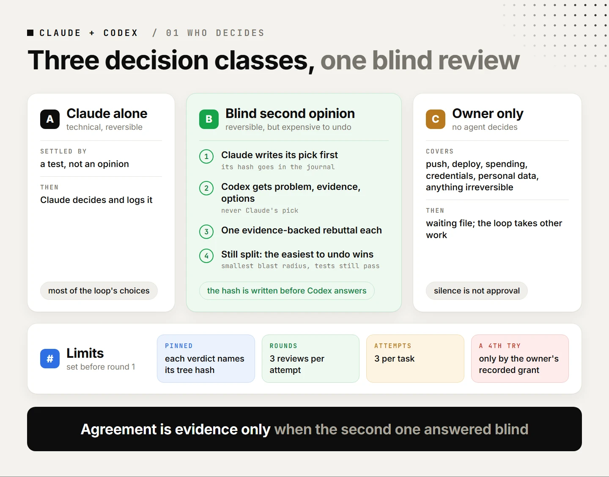
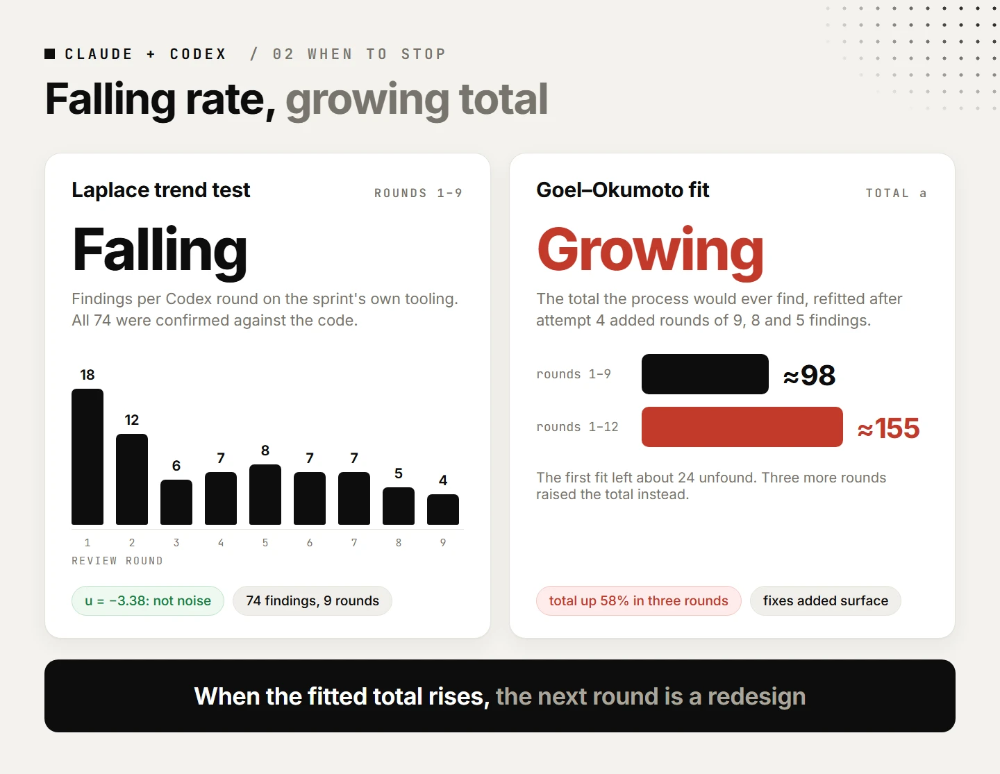

On two projects right now, Claude Code writes the code and OpenAI's Codex CLI reviews it, inside a loop that runs for days without me typing a prompt. The pairing is only worth its tokens under a few conditions: the reviewer gives its answer before it sees the author's, every verdict attaches to an exact tree, rounds are capped, disagreement has a rule, and some decisions are never made by either model. None of those rules needed intuition about AI. Research on LLM judges, model debate and software inspection had already measured each failure they guard against. And the review log is data: a decades-old reliability test on the number of findings per round told me more about when to stop than any single verdict did.

## Asking the same model to check itself mostly returns the same answer

The cheapest design is one model that writes and then reviews its own work. Huang et al. tested that at ICLR 2024: without feedback from outside the model, asking GPT-3.5 to find and fix mistakes in its own reasoning lowered accuracy on every benchmark they ran. Liang et al. named the mechanism **Degeneration-of-Thought** — once a model is confident in an answer, reflecting on it stops producing new ideas, even when the answer is wrong. Grading its own work adds a second problem. Panickssery, Bowman and Feng found that GPT-4 picked out its own summaries 73.5% of the time and tended to prefer them, and that after fine-tuning, self-recognition and self-preference rose together. Their study covered summarization only and could not show the preference was undeserved, and Zheng et al. saw only suggestive signs of the same bias in MT-Bench. That is enough for me to keep the author out of the reviewer's seat. It is not proof that a model always overrates itself.

So the reviewer comes from a different vendor. A Cohere preprint by Verga et al. points the same way for evaluation: a panel of three smaller models from three families agreed with human judgments better than GPT-4 alone, with a Cohen's κ of 0.763 against 0.627 on one question-answering set. A second vendor buys less independence than it seems to, though. Kim et al. measured error agreement across hundreds of models at ICML 2025. On four-option MMLU questions, two models that are both wrong pick the same wrong option about 60% of the time, where chance is a third, and sharing a provider adds only a little to that. More accurate models are more correlated, not less. That is why neither model gets the last word on correctness — the test suite, the type checker and an end-to-end run against a throwaway database do.

## The reviewer never sees my recommendation, because seeing it is the bias

Most of the loop's choices fall in what the charter calls class A: technical, reversible, and settled by a test. Claude makes those alone and logs them. Class B covers choices that are reversible but expensive — the shape of an API, for instance, or a data rule — and it runs a blind protocol. Claude writes its choice into the decision log first and records the hash of that entry in the journal. Codex then gets the problem, the evidence and the options, without Claude's pick. Each side gets one evidence-backed rebuttal. If they still differ, the charter chooses the option that is easiest to undo with the smallest blast radius, provided the tests and the mandate still hold, and the decision is marked as made under disagreement.



Every clause there answers a known failure. Showing the reviewer the author's answer first is the setup Sharma et al. studied as **sycophancy**: when a user suggested a wrong answer, or simply asked "are you sure?", the 2023-era models they tested often gave up correct answers. People do the same. In Lorenz et al.'s PNAS experiment, letting participants see each other's estimates narrowed the spread of answers without reducing the group's error. Delphi questionnaires start the same way, with each expert answering alone before any controlled feedback from the group. The tie-break is a written rule rather than a third model acting as judge, because Liang et al. themselves warn that an LLM judge may not be fair when the debaters are different models. If I could keep only one clause, it would be the hash written before Codex answers. It stops the author from quietly adopting the reviewer's answer and reporting the result as agreement.

## A verdict pinned to nothing in particular is not a verdict

In the sprint I run for an internal marketing-intelligence app at a multi-branch aesthetic clinic chain, the reviewer never touches the repository. A script exports the staged tree with `git archive`, checks every path against an allowlist, drops `.git`, dotenv files and anything shaped like a credential, and assembles a package: the task's acceptance criteria, the diff, the full text of each changed file and its direct imports, and the verification claims. Nothing from Claude's own reasoning goes in: no recommendation, no decision notes. Codex reads that package in a locked-down container with every tool switched off, and it has to return the tree hash it reviewed, or the review counts as an error. A commit is refused unless its tree is byte-identical to the approved one, and it must carry two trailers:

```text
Sprint-Task: <task id>        # the queue row this commit closes, so a crash can be reconciled from git alone
Reviewed-Tree: <tree hash>    # the exact bytes the reviewer approved; any later edit is a new tree and a new review
```

Huang et al.'s negative result has a positive half: self-correction does work when the feedback comes from outside the model. Pinning the review to a tree is what keeps that outside feedback attached to the code it was about, instead of drifting onto whatever the branch holds an hour later.

## Three rounds is a budget, and parking a plan is a valid outcome

Debate between models does help in some setups. Du et al. had three ChatGPT instances argue for two rounds and saw accuracy on GSM8K math problems rise from 77% for a single agent to 85%. Most of that gain comes from asking more than once, not from arguing. Huang et al. compared debate with plain majority voting at the same number of responses and found debate behind. Smit et al. found that debate strategies don't reliably beat self-consistency unless their settings are tuned. Choi, Zhu and Li proved at NeurIPS 2025 that debate on its own leaves the agents' expected correctness unchanged, with voting explaining most of the reported gains. Another round of the same conversation is not a plan. So the charter caps each attempt at three review rounds and each task at three attempts. A fourth attempt exists only as a recorded grant from me, and the grant names the decision it came from.

On AIDA, the open-source helpdesk where this pattern ran first, the cap did its job three times in a row. Phases 8, 9 and 10 were each planned and put through three Codex plan-review cycles. Each third cycle still returned HIGH findings, so each phase was parked with no code executed, and the loop moved on to Phase 11. That phase was built, and two rounds of Codex diff critique on it found three places where older pages read or wrote data without checking the user's membership. Nothing had reached those pages that way before; the phase's new command palette had just made them reachable.

## The findings-per-round series says whether to review again or redesign

The sprint's first job was its own tooling: the task runner, a sandboxed environment wrapper, and the reviewer harness itself. The first nine Codex rounds on that tooling returned 18, 12, 6, 7, 8, 7, 7, 5 and 4 findings — 74 in all, every one confirmed against the code. Software-reliability engineering has standard tools for a series like that. The **Laplace trend test** for grouped data, as Kanoun and Laprie describe it, asks whether the rate of findings is really falling. The **Goel–Okumoto model** fits the cumulative count to m(t) = a(1 − e^(−bt)), where a is the total the process would eventually find.

```text
rounds 1-9   findings 18 12 6 7 8 7 7 5 4   (74 total)
Laplace u    = -3.38      # below about -2 (the 5% level): the rate really is falling, not noise
Goel-Okumoto a ≈ 98, b ≈ 0.16 → about 24 still unfound, about 3.5 expected next round
attempt 4    findings 9 8 5   # same tooling, plus mechanisms added for the pilot run
refit on all 12 rounds: a ≈ 155   # the estimated total grew 58% in three rounds
```



Read the two fits together. Goel–Okumoto treats a as a constant: a fixed pool of defects that fixing only drains. When fixes add faults, it is the wrong model, which is why imperfect-debugging variants such as Pham, Nordmann and Zhang's let fault content grow over time. A total that jumps from 98 to 155 when three rounds are added says the pool was not fixed: fixes and new mechanisms were adding surface about as fast as review removed it. That is not a cue to review harder. It is a cue to change the design. The session got there from the findings themselves. After two rounds in a row found new holes in a heuristic shell-argument parser, it replaced the parser with a fixed allowlist of launchers, and its decision log gives the reason as removing the class of problem instead of patching case by case. The next round still found five narrower gaps, in the allowlist itself. The gate passed later that night, and the next three product tasks were each approved in their first review round.

Nine points from one gate is a small sample, and I wouldn't set a threshold from it. What it gives me is a rule I can compute instead of a feeling: when the trend test stops showing a decline, or the fitted total rises as rounds are added, the next round goes to a redesign, not another review.

## Two reviewers are too few to count what neither of them found

The next tool I want comes from software inspection, not AI research. Eick et al. adapted **capture–recapture**, the ecologist's way of estimating a population from two catches, to estimate how many faults a design document still holds after review. If reviewer A finds n₁ issues, reviewer B finds n₂, and m are found by both, the Lincoln–Petersen estimate of the total is n₁·n₂/m. With illustrative counts of 12, 10 and 6, that is 20, four more than the 16 distinct findings in hand.

Two reviewers is exactly where the method is weakest. Briand et al. evaluated these models on real inspection data and found that they tend to underestimate, that they are rather inaccurate with fewer than four inspectors, and that they should not be used below four unless shown to work in your environment. Correlated reviewers make it worse, because shared blind spots inflate m and shrink the estimate. So with two models I'd read the overlap as a direction, not a count: little overlap between two blind reviews means much is left, while heavy overlap between two correlated models reassures less than it seems to. The setup Briand recommends — four or five inspectors and a model that lets defects differ in how easy they are to find — would mean several fresh, blind reviewers from both vendors on the same package. I haven't run it. It is the next change to the charter, not a result.

## Agreement between two agents still does not replace the owner

The third class is short and absolute. Push, merge, deploy, real infrastructure, new spending, credentials, personal data, destructive migrations and anything irreversible go into a waiting file, and the loop picks up other work. The charter states that silence is not approval and that two agents agreeing does not replace the owner. Condorcet's jury theorem says why: a majority beats its members only when there are enough voters erring independently, and Kaniovski showed that positive correlation between votes lowers the jury's competence. Two correlated voters are not a jury, and two cannot form a majority anyway.

That waiting file turned out to be the real limit on throughput. On the sprint's second day, the work the agents could do alone was projected to run dry within days, while fourteen tasks waited on product questions only I could answer. Raising the daily attempt cap would not have changed that; answering would. Each answer is written into the charter as a rule, so the same question never comes back.

A second model earns its tokens only when it is set up to disagree with the first, and the record of how often it still does is the cheapest stopping rule you will ever get.

---

## Sources

- ICLR 2024, Huang et al. — *Large Language Models Cannot Self-Correct Reasoning Yet* (intrinsic self-correction without external feedback lowered accuracy; debate trailed majority voting at equal responses). Retrieved 2026-11-14. <https://arxiv.org/abs/2310.01798>
- EMNLP 2024, Liang et al. — *Encouraging Divergent Thinking in Large Language Models through Multi-Agent Debate* (Degeneration-of-Thought; an LLM judge may be unfair when debaters are different models). Retrieved 2026-11-14. <https://arxiv.org/abs/2305.19118>
- NeurIPS 2024, Panickssery, Bowman & Feng — *LLM Evaluators Recognize and Favor Their Own Generations* (GPT-4 self-recognition 73.5%; self-recognition and self-preference correlate after fine-tuning; summarization only). Retrieved 2026-11-14. <https://arxiv.org/abs/2404.13076>
- NeurIPS 2023 Datasets and Benchmarks, Zheng et al. — *Judging LLM-as-a-Judge with MT-Bench and Chatbot Arena* (self-enhancement observed but not established). Retrieved 2026-11-14. <https://arxiv.org/abs/2306.05685>
- arXiv preprint, Verga et al. — *Replacing Judges with Juries: Evaluating LLM Generations with a Panel of Diverse Models* (three-family panel κ 0.763 vs GPT-4 0.627 on one QA set). Retrieved 2026-11-14. <https://arxiv.org/abs/2404.18796>
- ICML 2025, Kim, Garg, Peng & Garg — *Correlated Errors in Large Language Models* (models that are both wrong agree about 60% of the time on MMLU against a one-third chance level; same provider adds little; more accurate models are more correlated). Retrieved 2026-11-14. <https://arxiv.org/abs/2506.07962>
- ICLR 2024, Sharma et al. — *Towards Understanding Sycophancy in Language Models* (models abandon correct answers under user pushback or suggested answers). Retrieved 2026-11-14. <https://arxiv.org/abs/2310.13548>
- PNAS, Lorenz, Rauhut, Schweitzer & Helbing — *How social influence can undermine the wisdom of crowd effect* (seeing others' estimates reduced diversity without reducing collective error). Retrieved 2026-11-14. <https://doi.org/10.1073/pnas.1008636108>
- Management Science, Dalkey & Helmer — *An Experimental Application of the Delphi Method to the Use of Experts* (expert questionnaires with controlled opinion feedback). Retrieved 2026-11-14. <https://doi.org/10.1287/mnsc.9.3.458>
- ICML 2024, Du, Li, Torralba, Tenenbaum & Mordatch — *Improving Factuality and Reasoning in Language Models through Multiagent Debate* (three agents, two rounds: GSM8K 77% to 85%). Retrieved 2026-11-14. <https://arxiv.org/abs/2305.14325>
- ICML 2024, Smit et al. — *Should we be going MAD? A Look at Multi-Agent Debate Strategies for LLMs* (debate does not reliably beat self-consistency without tuning). Retrieved 2026-11-14. <https://arxiv.org/abs/2311.17371>
- NeurIPS 2025, Choi, Zhu & Li — *Debate or Vote: Which Yields Better Decisions in Multi-Agent Large Language Models?* (majority voting explains most debate gains; debate alone does not raise expected correctness). Retrieved 2026-11-14. <https://arxiv.org/abs/2508.17536>
- IEEE Transactions on Software Engineering, Kanoun & Laprie — *Software reliability trend analyses from theoretical to practical considerations* (Laplace trend test for failure intensity). Retrieved 2026-11-14. <https://doi.org/10.1109/32.317434>
- IEEE Transactions on Reliability, Goel & Okumoto — *Time-Dependent Error-Detection Rate Model for Software Reliability and Other Performance Measures* (NHPP mean-value function m(t) = a(1 − e^(−bt)) with a finite expected total). Retrieved 2026-11-14. <https://doi.org/10.1109/TR.1979.5220566>
- IEEE Transactions on Reliability, Pham, Nordmann & Zhang — *A general imperfect-software-debugging model with S-shaped fault-detection rate* (fault content that grows as debugging introduces faults). Retrieved 2026-11-14. <https://doi.org/10.1109/24.784276>
- ICSE 1992, Eick, Loader, Long, Votta & Vander Wiel — *Estimating software fault content before coding* (capture–recapture applied to design reviews). Retrieved 2026-11-14. <https://doi.org/10.1109/ICSE.1992.753490>
- IEEE Transactions on Software Engineering, Briand, El Emam, Freimut & Laitenberger — *A comprehensive evaluation of capture-recapture models for estimating software defect content* (Lincoln–Petersen from two inspectors; estimates tend to underestimate and should not be used below four inspectors unless validated). Retrieved 2026-11-14. <https://doi.org/10.1109/32.852741>
- Theory and Decision, Kaniovski — *Aggregation of correlated votes and Condorcet's Jury Theorem* (positive correlation between votes lowers jury competence). Retrieved 2026-11-14. <https://doi.org/10.1007/s11238-008-9120-4>
