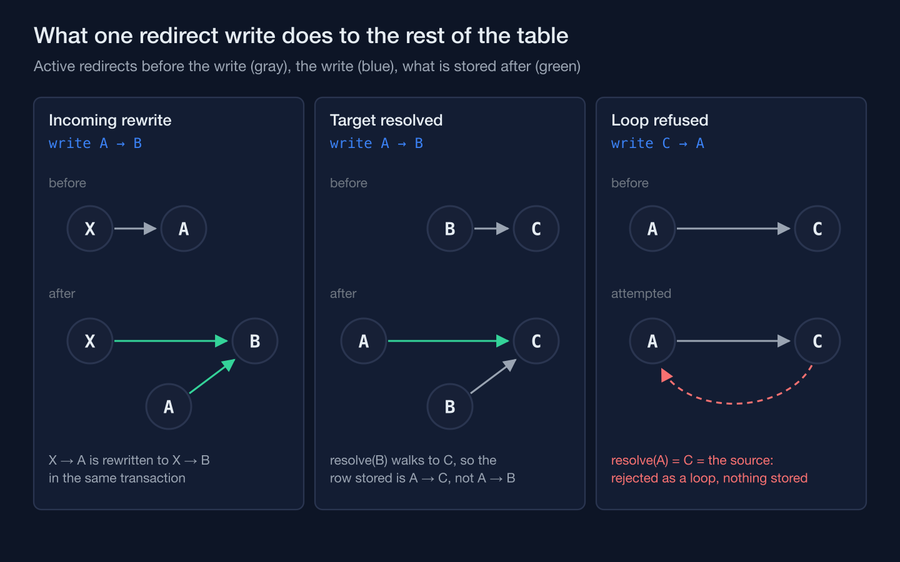
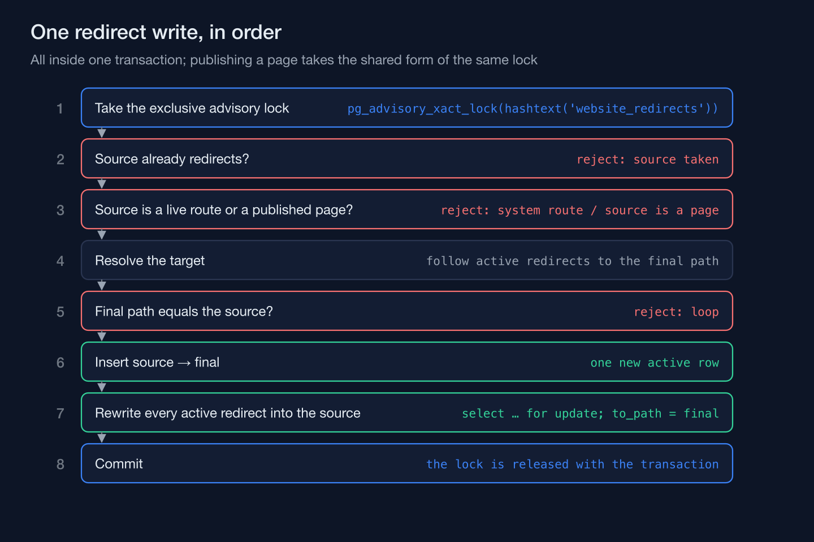

On a training-academy information system I'm building, admins can retire an old URL by pointing it at a new one — a program page gets a new permalink, an article moves, the old address becomes a redirect. The naive version of that feature is one row: old path, new path, a 301. The actual feature can't be one row, because the table isn't a list of independent facts, it's a graph, and every insert either keeps that graph free of chains and loops or it doesn't. A redirect write that only checks "does this source already redirect somewhere" is checking the wrong thing. It also has to check what happens to everyone who already redirects *into* the node it's about to touch.

## A redirect created today can turn one made yesterday into a chain

Say an admin redirected an old page, `X`, to `A`, months ago. Today they retire `A` itself and redirect it to `B`. If the system does nothing more than insert `A → B`, then `X` is now a two-hop chain: `X → A → B`. Nothing about that insert looks wrong in isolation — it's a perfectly valid new row. The damage is to a redirect that was already live before this write ever happened, and the damage is invisible unless something specifically looks for it.

The write path treats every insert as a graph edit, not a row append. Before anything is stored, it resolves the target all the way to its final destination (condensed, docblock translated from the codebase's Indonesian):

```php
/** Final destination: follow active redirects from the target path until they stop. */
public function resolve(string $to): string
{
    $final = $to;
    $seen = [];

    while (($next = WebsiteRedirect::query()->where('status', 'active')
        ->where('from_path', RedirectRules::pathOf($final))->value('to_path')) !== null) {
        if (isset($seen[$next])) {
            break;
        }

        $seen[$next] = true;
        $final = (string) $next;
    }

    return $final;
}
```

The `$seen` set is defensive: if the table somehow already held a loop, the walk stops at the first repeat instead of spinning. The loop check below only refuses a walk that ends back at the new source.

So `A → B` is stored as `A → B` (nothing to resolve yet), but the insert doesn't stop there. It also finds every active redirect whose stored target is exactly the path being touched — in this case, anything pointing at `A` — and rewrites it in the same transaction to point at `B` directly. `X → A` becomes `X → B`. The chain that would have formed never exists, not even for the length of one request.



The last check runs after resolution: if the fully-walked target's path is the same as the source path itself, the write is rejected outright. That's the loop case — someone redirecting `A` to something that eventually comes back around to `A` — and it's caught by comparing the two paths, not by hoping the walk above never gets invoked on bad data. Keeping a redirect table loop-free and chain-free this way was a named requirement before a single row existed in it, which is a different posture than noticing the chain problem after the first support ticket about a page taking three hops to load.

All of this — the resolve, the insert, the rewrite of incoming edges — happens inside one transaction that first takes an exclusive advisory lock every redirect write shares, held until the transaction ends. Two admins retiring different pages at the same moment can't interleave their reads of "what does this currently point to" with each other's writes and produce a chain neither of them would have created alone.



## A valid-looking target is not the same as an internal path

A redirect's target also has to be constrained to something the system itself serves — otherwise the feature that lets an admin fix a broken link is also a feature that lets anyone with publishing rights, or anyone who takes over such an account, build an open redirect off the domain's own good reputation. The rule sounds simple: the target has to be a path, not a URL. In practice it's a few explicit string checks, a character-class regex, and a separate pattern for encoded sequences, with a schema CHECK repeating the basic shape in the database (class docblock translated and condensed):

```php
// Target: ONLY an internal path — one leading `/` (not `//`), no `\`, scheme,
// host, spaces or control characters, nor the encoded forms %09/%0A/%0D/%00;
// a query is allowed. The Location header is built from app.url.
private const TARGET = '/^\/[A-Za-z0-9._~\/%?=&+-]*$/';

private static function encodedControl(string $value): bool
{
    return preg_match('/%(0[0-9a-f]|1[0-9a-f]|7f|5c|2f%2f)/i', $value) === 1;
}
```

The first line of defense is ordinary: the target must start with exactly one `/`, never `//` (that's protocol-relative, and browsers will happily treat `//evil.example` as a scheme-relative URL to somewhere else entirely), never a backslash, never a scheme. Someone typing `https://attacker.example` into the target field never gets past that. But the character class has to allow `%`, because real internal paths legitimately contain percent-encoded characters — and the moment `%` is allowed, so is any two-digit hex pair after it, including `%0d%0a` (a carriage-return/line-feed pair) or `%00` (a null byte) or `%2f%2f` (an encoded `//`) or `%5c` (an encoded backslash). A regex built to accept normal encoded paths cannot, in the same breath, forbid every dangerous *encoded* byte, so a second pattern looks for those sequences in the encoded string itself instead of trusting the character class to have ruled them out. The feature's threat model names the open redirect explicitly, and the feature test runs a list of hostile targets through the create action.

One more layer sits underneath all of them: the `Location` header is built from the application's configured base URL plus the stored path, never from the Host header on the incoming request, and the tests send a forged Host to prove it. A forged Host header can get a server to answer a request; it can't get this redirect to send the visitor there.

## A redirect also can't shadow a path that still answers on its own

The last gate is on the source, not the target. An admin can't create a redirect whose source is a system route the router still matches, or a published program, article, landing or static page at that exact address. The table is only consulted on the not-found path, so without that check a mistaken redirect wouldn't error, and it wouldn't do anything either: on a route that never consults the table it would be a dead row, and on a published page it would sit dormant until the page was withdrawn, then silently take over its URL.

```php
private function assertSourceFree(string $from): void
{
    $route = rescue(fn () => Route::getRoutes()->match(Request::create($from, 'GET')), null, false);

    if ($route !== null && ! $route->isFallback && ! in_array($route->getName(), self::PATTERN_ROUTES, true)) {
        throw WebsiteRuleViolation::redirectSystemRoute();
    }

    if ($this->isLivePagePath($from)) {
        throw WebsiteRuleViolation::redirectSourceIsPage();
    }
}
```

Four pattern routes are allowed as sources anyway — the program, article, landing and trainer pages — because their own not-found path is where the redirect lookup runs, so a retired slug under one of them can still be redirected. Every other system route is off-limits as a redirect source, and so is a source that already has an active redirect.

## The redirects that skipped all of this were the ones nobody thought to call a redirect

Every guarantee above — no chains, no loops, no open targets, no rows parked on a live path — applies to rows in the redirect table. It has no reach at all over a `redirect()->to(...)` call written directly inside a controller, because that call was never a row to begin with. The system has a handful of those: when a session page is requested with its code in a different letter case, the controller notices the code doesn't match the canonical stored one and 301s to the canonical URL itself, inline (comment translated):

```php
// One URL per session: a lowercase or differently shaped code is not a second page.
if ($code !== $batch->code) {
    return redirect()->to(
        PublicUrl::withQuery(PublicUrl::route('public.schedule.show', ['code' => $batch->code]), $request),
        301,
    );
}
```

That `withQuery(...)` call wasn't always there. Until this change, this redirect and three siblings — an old session-code URL, a program slug in the wrong case, and a trainer's old slug — built their destination from the route alone and handed it straight to `redirect()->to()`. A marketing link pointing at one of those old-format addresses, with a campaign tag on the end of it, would land the visitor on exactly the right page. The tag itself just wasn't there anymore. No error, no failed request, no log line pointing at the gap — the redirect worked in every way anyone checking "does this link still go to the right place" would have checked. It surfaced in a gap review for the next phase, which was going to capture campaign tags at registration: the review noted that the old session-code redirect dropped the query string. The fix went through all four built-in 301s, not just that one, adding a single call that forwards the request's original query onto the destination the controller had already chosen. The managed lookup, written in the same commit, forwarded the visitor's query from the start whenever the stored target has no query of its own.

The table's lookup forwarded a visitor's query from the day it was written, and the four redirects written inline before it existed kept dropping campaign tags until a review went looking for them.
